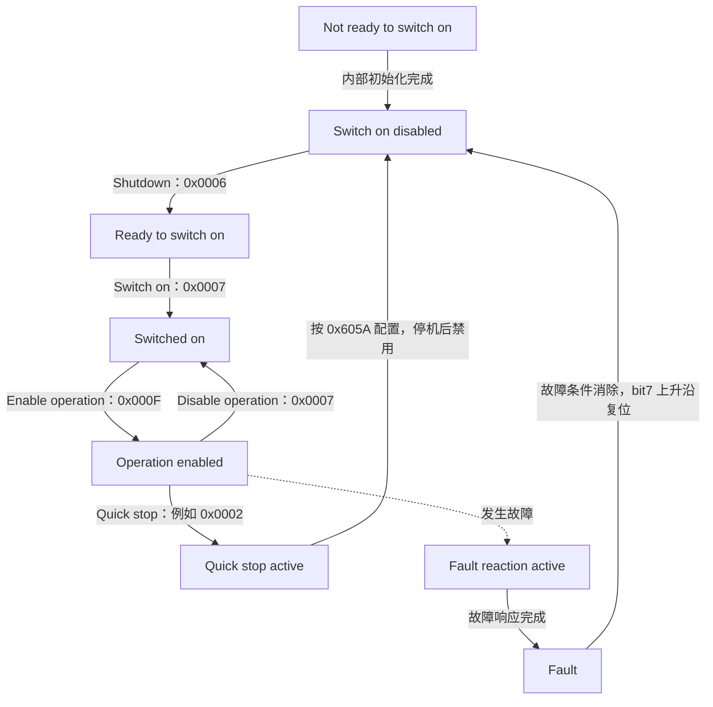
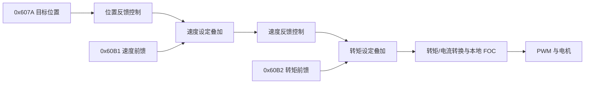

# CiA 402 学习笔记：从状态机到电机控制报文

刚接触步进电机或伺服驱动器时，经常会看到下面几条指令：

```text
601  2B 40 60 00 06 00 00 00
601  2B 40 60 00 07 00 00 00
601  2B 40 60 00 0F 00 00 00
```

照着手册发送，电机可能就使能了。但为什么是 `06 → 07 → 0F`？`601` 和 `581` 有什么关系？收到回复后，能不能马上发送目标位置？

这篇笔记结合cia402协议 报文自己的理解，再对照 CiA 官方说明与驱动器厂商文档，从对象含义、状态变化到报文字节逐步梳理。

## 1. CiA 402 到底规定了什么

`CiA` 是 CAN in Automation，`CiA 402` 是面向驱动器与运动控制的设备行规，旧资料里也常见 `DS402`、`DSP402` 的叫法。它规定了一套共同的驱动控制接口，核心包括对象字典、驱动状态机、控制字与状态字，以及位置、速度、转矩等运行模式。适用设备包括伺服驱动器、变频器和步进电机驱动器。[CiA 官方介绍](https://www.can-cia.org/can-knowledge/cia-402-series-canopen-device-profile-for-drives-and-motion-control)

我习惯把一次控制拆成三个问题：

| 问题 | 需要看的内容 | 例子 |
| --- | --- | --- |
| 参数表示什么？ | CiA 402 对象定义 | `0x607A` 是目标位置 |
| 当前允许做什么？ | CiA 402 驱动状态机 | 还没使能时不能正常执行运动 |
| 参数怎么送到设备？ | CANopen 或 EtherCAT CoE 通信机制 | 用 SDO 写对象，或用 PDO 周期交换 |

因此，读懂 CiA 402 不能只背几条 CAN 报文，还要理解报文里的对象和驱动器当前的状态。

CiA 402 的部分内容已纳入 IEC 61800-7 系列；CiA 官方也指出，不同设备可能实现不同的功能子集。所以，支持 CiA 402 能减少接口差异，但不保证两个驱动器可以不改配置就直接互换。[CiA 规范与兼容性说明](https://www.can-cia.org/can-knowledge/cia-402-series-canopen-device-profile-for-drives-and-motion-control)

## 2. 先认识对象字典

对象字典可以理解为驱动器对外提供的参数表。访问一个条目，需要指定：

```text
Index：16 位索引，表示哪个对象
Sub-index：8 位子索引，表示对象里的哪个条目
Value：按该条目的类型编码的数据
```

例如 `0x6040:00` 表示控制字对象的 `00` 子索引。简单变量常使用子索引 `00`；数组、记录的子索引有具体含义，不能一律填零。[Beckhoff 对象访问说明](https://infosys.beckhoff.com/content/1033/cx1500_fb_510/3222421003.html)

### 2.1 常用对象速查

下面列出常见的传统 32 位位置接口。`UINT` 表示无符号整数，`INT` 表示有符号整数；访问方向以主站为视角。

| 对象 | 名称 | 常见类型 | 用途 |
| --- | --- | --- | --- |
| `0x603F:00` | Error code | UINT16 | 读取驱动错误码 |
| `0x6040:00` | Controlword | UINT16 | 写入控制命令 |
| `0x6041:00` | Statusword | UINT16 | 读取驱动状态 |
| `0x605A:00` | Quick stop option code | INT16 | 选择快速停止行为 |
| `0x605B:00` | Shutdown option code | INT16 | 选择 Shutdown 行为 |
| `0x605C:00` | Disable operation option code | INT16 | 选择禁用运动操作时的行为 |
| `0x605D:00` | Halt option code | INT16 | 选择 Halt 行为 |
| `0x605E:00` | Fault reaction option code | INT16 | 选择故障响应行为 |
| `0x6060:00` | Modes of operation | INT8 | 请求运行模式 |
| `0x6061:00` | Modes of operation display | INT8 | 读取实际运行模式 |
| `0x6064:00` | Position actual value | INT32 | 读取实际位置 |
| `0x606C:00` | Velocity actual value | INT32 | 读取实际速度 |
| `0x6071:00` | Target torque | INT16 | 写入目标转矩 |
| `0x6077:00` | Torque actual value | INT16 | 读取实际转矩 |
| `0x607A:00` | Target position | INT32 | 写入目标位置 |
| `0x6081:00` | Profile velocity | UINT32 | 配置轮廓速度 |
| `0x6083:00` | Profile acceleration | UINT32 | 配置轮廓加速度 |
| `0x6084:00` | Profile deceleration | UINT32 | 配置轮廓减速度 |
| `0x6085:00` | Quick stop deceleration | UINT32 | 配置快速停止减速度 |
| `0x6087:00` | Torque slope | UINT32 | 配置轮廓转矩变化斜率 |
| `0x6098:00` | Homing method | INT8 | 选择回零方法 |
| `0x60B1:00` | Velocity offset | INT32 | 提供速度偏置，可用于前馈 |
| `0x60B2:00` | Torque offset | INT16 | 提供转矩偏置，可用于前馈 |
| `0x60FF:00` | Target velocity | INT32 | 写入目标速度 |

实际可访问对象、类型和 PDO 映射能力要查设备对象表；可以对照厂商手册中的 [CiA 402 对象列表](https://static.weg.net/medias/downloadcenter/h67/hde/WEG-CFW900-canopen-v1.02-users-guide-10009145043-en.pdf)。新版本行规还引入了 64 位位置接口，不宜把这里的 32 位布局套用到所有设备。

### 2.2 数值和物理单位是两回事

参考笔记中的步进驱动器示例，把加速度数据 `0x0000000A` 按该设备约定换算为 `1 rps/s`，把目标速度 `0x00000064` 解释为 `100 rpm`。这些换算需要设备手册提供比例和单位。

单看十六进制，只能得到：

```text
0x0000000A = 10
0x00000064 = 100
```

同样，目标位置 `10000` 不直接等于一圈或某个毫米数。要确认编码器计数、细分、电子齿轮、用户单位和机械传动关系。例如，若已知输出轴每圈对应 `10000` 个位置单位，那么相对位移 `10000` 才对应输出轴一圈。[Synapticon 目标位置单位说明](https://doc.synapticon.com/node/sw5.4/objects_html/6xxx/607a.html)

## 3. 通信正常，不代表电机已经使能

运动控制里经常同时存在两套状态机：

| 状态机 | 解决的问题 | 常见状态 |
| --- | --- | --- |
| CANopen NMT | 节点允许使用哪些通信服务 | Initialisation、Pre-operational、Operational、Stopped |
| EtherCAT ESM | 从站的邮箱和过程数据通信是否就绪 | Init、Pre-Op、Safe-Op、Op |
| CiA 402 PDS 状态机 | 驱动器是否允许执行运动 | Switch on disabled、Switched on、Operation enabled 等 |

CANopen 通常在 Pre-operational 阶段通过 SDO 配置参数，进入 Operational 后使用 PDO；NMT 的 Operational 不能直接当作电机使能成功。[CiA NMT 说明](https://www.can-cia.org/can-knowledge/network-management)

EtherCAT 的 Op 表示过程数据通信进入运行阶段，还要检查驱动状态、错误和运动使能条件。实践中，即使从站已经 Op、WKC 正常，驱动器也可能仍处于 Switch on disabled。[Beckhoff 通信与驱动状态监测](https://infosys.beckhoff.com/content/1033/ax2000-b110/15060861963.html)

可以结合上一篇 [EtherCAT 学习笔记](/posts/ethercat-learning-notes/) 理解：总线负责把数据送到，CiA 402 决定驱动器如何处理这些数据。

## 4. 驱动状态机：从上电到允许运动

### 4.1 八个基本状态

| 状态 | 中文理解 | 调试时关注什么 |
| --- | --- | --- |
| Not ready to switch on | 尚未准备好 | 等待内部初始化、自检完成 |
| Switch on disabled | 启动被禁止 | 尚未进入启动流程 |
| Ready to switch on | 已准备好启动 | 已接受 Shutdown 命令，等待下一步 |
| Switched on | 已启动 | 完成启动阶段，但运动操作尚未使能 |
| Operation enabled | 运动操作已使能 | 可以按当前模式处理有效目标值 |
| Quick stop active | 快速停止处理中或保持中 | 查看快速停止配置及实际速度 |
| Fault reaction active | 正在执行故障响应 | 等待设备完成配置的故障响应 |
| Fault | 故障状态 | 读取错误原因，处理后再复位 |

下面按厂商状态机文档整理了主要路径，省略了部分反向转移和组合命令。具体电压、抱闸及功率级动作还取决于设备实现。[Synapticon 状态机与命令表](https://doc.synapticon.com/node/system_integration/status_and_controlword.html)



图中的故障路径只从 Operation enabled 画出一条示意线；其他状态也可能发生故障。快速停止后也可能保持在 Quick stop active，是否支持直接恢复到 Operation enabled，要查设备的 `0x605A` 和状态转移说明。[快速停止选项说明](https://doc.synapticon.com/node/sw5.6/motion_control/advanced_control_options/quick_stop.htm)

### 4.2 控制字是请求，状态字是反馈

主站通过 `0x6040` 请求状态转移，驱动器结合当前状态、内部条件和收到的命令执行动作，再通过 `0x6041` 反馈实际状态。

工程上应该按下面的顺序推进：

```text
写控制字 → 读取新鲜状态字 → 确认预期状态 → 发送下一条命令
```

不能把“发送了 `0x000F`”当成“已经使能”。SDO 写入确认只能证明这次对象写访问成功，不能代替状态反馈；用 PDO 发送命令也同样需要等待驱动器反馈。[控制字与状态字的职责](https://doc.synapticon.com/node/sw5.4/objects_html/6xxx/6040.html)

## 5. 控制字 0x6040：为什么是 06、07、0F

控制字是 16 位字段，bit 编号从最低位 `bit0` 开始。下面列出常见位定义；模式相关位必须结合当前模式解释。[Controlword 定义](https://doc.synapticon.com/node/sw5.4/objects_html/6xxx/6040.html)

| 位 | 掩码 | 名称 | 含义 |
| --- | --- | --- | --- |
| bit0 | `0x0001` | Switch on | 请求启动 |
| bit1 | `0x0002` | Enable voltage | 电压使能请求 |
| bit2 | `0x0004` | Quick stop | `0` 表示快速停止请求，正常使能路径为 `1` |
| bit3 | `0x0008` | Enable operation | 请求使能运动操作 |
| bit4～6 | — | Mode specific | 按运行模式定义 |
| bit7 | `0x0080` | Fault reset | 用上升沿请求故障复位 |
| bit8 | `0x0100` | Halt | 按模式定义暂停或停止行为 |

拆开前三条控制字：

```text
                  bit3 bit2 bit1 bit0
0x0006 = 0110        0    1    1    0
0x0007 = 0111        0    1    1    1
0x000F = 1111        1    1    1    1
```

| 典型控制字 | 命令 | 在正常启动路径中的作用 |
| --- | --- | --- |
| `0x0006` | Shutdown | Switch on disabled → Ready to switch on |
| `0x0007` | Switch on | Ready to switch on → Switched on |
| `0x000F` | Enable operation | Switched on → Operation enabled |
| `0x0007` | Disable operation | Operation enabled → Switched on |
| `0x0000` | Disable voltage | 在适用状态下请求禁用电压 |
| `0x0002` | Quick stop | 在 Operation enabled 下请求快速停止 |
| `0x0080` 的 bit7 上升沿 | Fault reset | Fault → Switch on disabled，前提是可复位 |

这些是把其他位清零后的典型数值。实际命令由相关位组合决定，效果还取决于当前状态。比如同一个 `0x0007`，在启动路径上是 Switch on，在 Operation enabled 下则是 Disable operation。[CiA 402 命令组合表](https://doc.synapticon.com/node/system_integration/status_and_controlword.html)

参考笔记中把 `0x0006` 解释成已经进入 Switched on，这里需要修正：它是 Shutdown 命令，正常启动时请求 Ready to switch on。控制字的 bit1 为 `1` 也只表示请求，实际电压状态要查看设备反馈。

另外，Quick stop 的 bit2 是低有效，不能按名字理解成“置 1 才快速停止”。快速停止的减速和最终状态由 `0x605A` 等配置决定；它也不能直接代替 STO 等安全功能。[Synapticon 快速停止行为](https://doc.synapticon.com/node/sw5.6/motion_control/advanced_control_options/quick_stop.htm)

## 6. 状态字 0x6041：必须按掩码判断

### 6.1 状态字不只有状态机信息

| 位 | 常见含义 |
| --- | --- |
| bit0 | Ready to switch on |
| bit1 | Switched on |
| bit2 | Operation enabled |
| bit3 | Fault |
| bit4 | Voltage enabled |
| bit5 | Quick stop，正常运行编码中为 `1` |
| bit6 | Switch on disabled |
| bit7 | Warning |
| bit9 | Remote，支持情况依设备而定 |
| bit10 | Target reached，需按模式解释 |
| bit11 | Internal limit active |
| bit12～13 | 模式相关，例如 PP 的目标确认、回零结果 |

高位可能随警告、到位、限幅或模式反馈变化，不能直接用完整状态字等于某个常量来识别状态。[Statusword 定义](https://doc.synapticon.com/node/sw5.4/objects_html/6xxx/6041.html)

### 6.2 状态判定表

把厂商文档中状态编码的有效位换算成掩码，可以得到下面这张表。`x` 位不参与对应状态的判断。[状态编码原表](https://doc.synapticon.com/node/system_integration/status_and_controlword.html)

| 状态 | 掩码 | 掩码后的值 | 判断式 |
| --- | --- | --- | --- |
| Not ready to switch on | `0x004F` | `0x0000` | `(sw & 0x004F) == 0x0000` |
| Switch on disabled | `0x004F` | `0x0040` | `(sw & 0x004F) == 0x0040` |
| Ready to switch on | `0x006F` | `0x0021` | `(sw & 0x006F) == 0x0021` |
| Switched on | `0x006F` | `0x0023` | `(sw & 0x006F) == 0x0023` |
| Operation enabled | `0x006F` | `0x0027` | `(sw & 0x006F) == 0x0027` |
| Quick stop active | `0x006F` | `0x0007` | `(sw & 0x006F) == 0x0007` |
| Fault reaction active | `0x004F` | `0x000F` | `(sw & 0x004F) == 0x000F` |
| Fault | `0x004F` | `0x0008` | `(sw & 0x004F) == 0x0008` |

两种掩码都忽略 bit4 和高位；`0x004F` 还忽略 bit5，因为它在对应状态编码中属于无关位。

例如下面三个值都能解码成 Operation enabled：

```text
0x0027 & 0x006F = 0x0027
0x0237 & 0x006F = 0x0027
0x1237 & 0x006F = 0x0027
```

但它们携带的额外反馈不同，解码状态后仍应单独处理警告、限幅和模式位。也不要只看 bit2：Quick stop active 的状态编码同样包含 bit2 为 `1`。

### 6.3 C 语言状态解码示例

```c
#include <stdint.h>

typedef enum {
    CIA402_NOT_READY,
    CIA402_SWITCH_ON_DISABLED,
    CIA402_READY_TO_SWITCH_ON,
    CIA402_SWITCHED_ON,
    CIA402_OPERATION_ENABLED,
    CIA402_QUICK_STOP_ACTIVE,
    CIA402_FAULT_REACTION_ACTIVE,
    CIA402_FAULT,
    CIA402_UNKNOWN
} cia402_state_t;

cia402_state_t cia402_decode_state(uint16_t sw)
{
    switch (sw & 0x004Fu) {
    case 0x0000u: return CIA402_NOT_READY;
    case 0x0040u: return CIA402_SWITCH_ON_DISABLED;
    case 0x000Fu: return CIA402_FAULT_REACTION_ACTIVE;
    case 0x0008u: return CIA402_FAULT;
    default: break;
    }

    switch (sw & 0x006Fu) {
    case 0x0021u: return CIA402_READY_TO_SWITCH_ON;
    case 0x0023u: return CIA402_SWITCHED_ON;
    case 0x0027u: return CIA402_OPERATION_ENABLED;
    case 0x0007u: return CIA402_QUICK_STOP_ACTIVE;
    default: return CIA402_UNKNOWN;
    }
}
```

这是状态解码函数。主站程序还要确认反馈有效、处理超时，并记录原始状态字；未知编码不能当作“已经使能”。

## 7. CANopen SDO 报文：逐字节拆开

### 7.1 601 和 581 表示什么

对于默认 SDO 通道、节点 ID 为 `1` 的经典 CANopen 设备：

```text
主站 → 驱动器：0x600 + Node-ID = 0x601
驱动器 → 主站：0x580 + Node-ID = 0x581
```

这里的 `601`、`581` 都是十六进制 CAN 标识符，位于 CAN 帧头，不属于后面的 8 字节数据。`0x581` 表示这个 SDO 通道的响应方向，成功和失败都可能使用它；需要继续解析数据区的命令字节。[Beckhoff SDO 帧格式](https://infosys.beckhoff.com/content/1033/cx1500_fb_510/3222421003.html)

### 7.2 写入控制字 0x0006

```text
CAN-ID  DLC  数据区
0x601    8   2B 40 60 00 06 00 00 00
```

| 字节 | 值 | 解释 |
| --- | --- | --- |
| byte0 | `2B` | 带长度指示的 expedited SDO 写请求，有效数据 2 字节 |
| byte1 | `40` | 索引 `0x6040` 的低字节 |
| byte2 | `60` | 索引 `0x6040` 的高字节 |
| byte3 | `00` | 子索引 |
| byte4～5 | `06 00` | 小端数据，表示 `0x0006` |
| byte6～7 | `00 00` | 未使用的数据字节，本例填零 |

因此它的含义是：**向节点 1 的 `0x6040:00` 写入 UINT16 值 `0x0006`。**

参考笔记把 CMD 放在“报文长度”一节，容易和 CAN 的 DLC 混淆。DLC 是 CAN 数据区长度；SDO 的 CMD 则同时编码服务类型、传输方式和有效数据长度。本节讨论的是最多 4 字节的 expedited 传输，更长数据有其他传输流程。[CiA SDO 传输机制](https://www.can-cia.org/can-knowledge/sdo-protocol)

### 7.3 常见 CMD 和应答

| 有效数据长度 | 带长度指示的写请求 CMD | 带长度指示的读响应 CMD |
| --- | --- | --- |
| 1 字节 | `0x2F` | `0x4F` |
| 2 字节 | `0x2B` | `0x4B` |
| 3 字节 | `0x27` | `0x47` |
| 4 字节 | `0x23` | `0x43` |

读请求使用 `0x40`；写成功响应使用 `0x60`；SDO Abort 使用 `0x80`。这些值可对照 [Beckhoff 的 expedited SDO 协议表](https://infosys.beckhoff.com/content/1033/cx1500_fb_510/3222421003.html)。

下面是由帧格式构造的两个例子：

```text
# 写 0x6040:00 = 0x0006
请求：0x601  2B 40 60 00 06 00 00 00
成功：0x581  60 40 60 00 00 00 00 00

# 读 0x6041:00，假设设备返回 0x0021
请求：0x601  40 41 60 00 00 00 00 00
响应：0x581  4B 41 60 00 21 00 00 00
```

第二个响应里的 `21 00` 解码为 `0x0021`，再按状态掩码判断为 Ready to switch on。实际设备也可能返回带其他标志位的状态字。

如果收到：

```text
0x581  80 40 60 00 00 00 02 06
```

最后四字节按小端解码为 `0x06020000`，表示访问的对象不存在。排查时要匹配节点、Index、Sub-index，并区分 SDO Abort 与驱动器的 `0x603F` 错误码。[SDO Abort 错误码表](https://infosys.beckhoff.com/content/1033/cx1500_fb_510/3222421003.html)

## 8. 例子一：用 SDO 控制步进电机速度

下面沿用参考笔记的节点 `1`，假设设备支持 Profile velocity 模式、允许通过 SDO 写控制字和目标速度。这里先配置模式和参数，再使能；每次 SDO 写入都要检查响应，每次状态转移都要等待状态字确认。

### 8.1 配置模式和参数

| 操作 | 发给 `0x601` 的数据区 | 含义 |
| --- | --- | --- |
| 选择 PV 模式 | `2F 60 60 00 03 00 00 00` | `0x6060:00 = 3` |
| 设置加速度 | `23 83 60 00 0A 00 00 00` | `0x6083:00 = 10` |
| 设置减速度 | `23 84 60 00 0A 00 00 00` | `0x6084:00 = 10` |
| 初始化目标速度 | `23 FF 60 00 00 00 00 00` | `0x60FF:00 = 0` |

`0x6060` 是请求模式，实际生效模式由 `0x6061` 反馈。应读取 `0x6061:00`，确认值为 `3`，并按手册配置限速及停机参数。[运行模式对象说明](https://doc.synapticon.com/node/sw5.4/objects_html/6xxx/6060.html)

这里的加减速度 `10` 仅用于展示原笔记的编码方式，不能直接作为其他驱动器的调试参数。

### 8.2 按状态推进使能

| 当前反馈状态 | 写入 `0x6040` | 发送数据区 | 等待的状态 |
| --- | --- | --- | --- |
| Switch on disabled | `0x0006` | `2B 40 60 00 06 00 00 00` | Ready to switch on |
| Ready to switch on | `0x0007` | `2B 40 60 00 07 00 00 00` | Switched on |
| Switched on | `0x000F` | `2B 40 60 00 0F 00 00 00` | Operation enabled |

每一步都读取 `0x6041` 并使用前面的掩码。如果状态不变化，要检查故障、硬件使能、供电和设备要求，不能无限循环发送下一条命令。状态迁移可能跨多个控制周期，不适合靠固定延时猜测完成时间。

### 8.3 写目标速度并观察反馈

```text
# 写 0x60FF:00 = 100
0x601  23 FF 60 00 64 00 00 00

# 读 0x606C:00 实际速度
0x601  40 6C 60 00 00 00 00 00
```

在原笔记对应设备的单位约定下，目标值 `100` 表示 `100 rpm`。还要结合实际速度、方向、状态字和错误码判断运动结果。SDO 返回成功，只证明目标速度对象写入成功。

负速度必须按 INT32 补码编码。例如 `-100` 是 `0xFFFFFF9C`，对应的小端数据为 `9C FF FF FF`。能否反转、允许的速度范围以及物理单位都要查设备手册。

需要停下时，可按 PV 模式和设备配置把目标速度设为零，观察实际速度下降；若要禁用驱动，再执行相应状态转移。Shutdown、Disable operation、Quick stop 和 Halt 的动作不同，不能把任意一条都理解成同一种减速停车。

## 9. 例子二：PP 模式为什么写位置还不够

Profile position（PP，模式 `1`）由驱动器根据目标位置、轮廓速度和加减速度生成轨迹。常见流程是配置 `0x6081`、`0x6083`、`0x6084`，确认模式与使能状态，再提交新目标。

PP 用控制字 bit4 的上升沿通知“这是一个新目标”，状态字 bit12 用于确认接收。仅写 `0x607A`，或者连续保持 bit4 为 `1`，都不能替代一次新的上升沿。[Synapticon PP 模式与握手说明](https://doc.synapticon.com/node/sw5.1/motion_control/operation_modes/profiled_modes/profile_position.html)

下面假设设备支持绝对位置、立即采用新目标的方式，bit5 为 `1`、bit6 为 `0`，Halt 为 `0`：

```text
1. 保持控制字 0x002F：bit4 = 0，bit5 = 1
2. 确认状态字 bit12 = 0，允许提交新目标
3. 写入目标位置 0x607A，例如 10000
4. 写控制字 0x003F：bit4 从 0 变 1
5. 等待状态字 bit12 = 1，确认目标被接收
6. 写控制字 0x002F：清除 bit4
7. 等待状态字 bit12 = 0，完成握手
8. 继续观察到位反馈、实际位置与故障状态
```

bit5 的缓冲/立即执行支持情况、bit6 的绝对/相对支持情况需核对设备手册。这里选择立即执行，不能用于需要排队完成多段位置命令的场景。

三个反馈要分开看：

| 反馈 | 能说明什么 |
| --- | --- |
| SDO 写入确认 | 对象访问成功 |
| PP 的 Set-point acknowledge | 新目标被接收 |
| PP 的 Target reached | 满足当前模式定义的到位条件 |

在正常 PP 定位、Halt 为 `0` 的前提下，bit10 常按位置窗口和窗口时间判断到位。提交新目标后，不应直接把上一条命令遗留的 bit10 当作本次完成，还要结合本次握手和位置反馈。厂商对 Halt、到位窗口和目标处理的细节可能不同。[PP 状态反馈说明](https://doc.synapticon.com/node/sw5.1/motion_control/operation_modes/profiled_modes/profile_position.html)

## 10. PDO 和 EtherCAT CoE：对象相同，传输方式不同

### 10.1 SDO 用来访问对象，PDO 用来交换过程数据

SDO 按 Index/Sub-index 访问参数，带请求和应答，适合配置、查询与低频调试。PDO 按预先配置的映射传输过程数据，可以周期、事件或同步触发，适合控制字、目标值、状态字和实际值的交换。

PDO 的普通数据区不逐项携带对象索引，解析双方必须使用相同的映射顺序和位长。经典 CANopen 的单个 PDO 最多承载 8 字节，不能照搬 EtherCAT 下更长的过程数据布局。[CiA PDO 机制](https://www.can-cia.org/can-knowledge/pdo-protocol)

例如，假设某个 RxPDO 按下面顺序映射：

```text
0x6040:00  UINT16  控制字    映射项 0x60400010
0x607A:00  INT32   目标位置  映射项 0x607A0020
```

映射项的结构为 `Index（16 位）+ Sub-index（8 位）+ 位长（8 位）`。按这份假设映射，控制字 `0x000F`、目标位置 `10000 = 0x00002710` 对应 6 字节过程数据：

```text
0F 00 10 27 00 00
```

这里没有 SDO 的 `2B` 或 `23`，因为接收方已经知道各字节属于哪个对象。映射需要设备支持，配置步骤和可修改状态应按手册执行。[Beckhoff PDO 映射示例](https://infosys.beckhoff.com/content/1033/tcsystemmanager/1090757771.html)

### 10.2 RxPDO / TxPDO 的方向以驱动器为准

| 名称 | 驱动器视角 | 主站视角 | 常见对象 |
| --- | --- | --- | --- |
| RxPDO | 接收数据 | 输出数据 | 控制字、目标位置、目标速度 |
| TxPDO | 发送数据 | 输入数据 | 状态字、实际位置、实际速度 |

### 10.3 EtherCAT CoE 下怎么理解

CoE 是 CANopen over EtherCAT。驱动器仍可使用对象字典和 CiA 402 接口，但传输承载变成 EtherCAT：参数通过邮箱 SDO 访问，实时目标与反馈通过过程数据交换。

因此，在 EtherCAT 主站里写 `0x6040`、读 `0x6041`，不需要构造 `0x601`、`0x581` 这类 CAN 标识符。工程上要同时确认 EtherCAT 通信状态、PDO 布局、反馈有效性和驱动状态。[Beckhoff EtherCAT 驱动接口手册](https://download.beckhoff.com/download/Document/motion/ax2000-b110_en.pdf)

### 10.4 带前馈的 CSP 过程数据布局

下面是一组教学布局，采用传统 32 位位置对象，假设驱动器支持所列对象的 PDO 映射。偏移从各方向的数据区起点计算，单位为字节；实际顺序要以配置和设备描述文件为准。

| 方向 | 对象 | 类型 | 字节数 | 在示例数据区中的偏移 |
| --- | --- | --- | --- | --- |
| Rx | `0x6040:00` 控制字 | UINT16 | 2 | 0 |
| Rx | `0x607A:00` 目标位置 | INT32 | 4 | 2 |
| Rx | `0x60B1:00` 速度偏置 | INT32 | 4 | 6 |
| Rx | `0x60B2:00` 转矩偏置 | INT16 | 2 | 10 |
| Tx | `0x6041:00` 状态字 | UINT16 | 2 | 0 |
| Tx | `0x6064:00` 实际位置 | INT32 | 4 | 2 |
| Tx | `0x606C:00` 实际速度 | INT32 | 4 | 6 |
| Tx | `0x6077:00` 实际转矩 | INT16 | 2 | 10 |

Rx 和 Tx 各需要 `2 + 4 + 4 + 2 = 12` 字节。速度、转矩偏置的类型可对照 [0x60B1](https://doc.synapticon.com/node/sw5.4/objects_html/6xxx/60b1.html) 和 [0x60B2](https://doc.synapticon.com/node/sw5.4/objects_html/6xxx/60b2.html) 对象说明。

在 EtherCAT CoE 中，可以按设备允许的映射和 PDO 分配组织这两组过程数据；不能仅因为主站能定义这份布局，就认为从站一定接受。

经典 CANopen 的单个 PDO 最多 8 字节，所以这组数据必须拆分。例如：

```text
RPDO A：控制字 2 + 目标位置 4 = 6 字节
RPDO B：速度偏置 4 + 转矩偏置 2 = 6 字节
TPDO A：状态字 2 + 实际位置 4 = 6 字节
TPDO B：实际速度 4 + 实际转矩 2 = 6 字节
```

拆分后的多帧数据不天然构成一次原子更新。需要按设备支持的同步 PDO、SYNC 和应用周期机制，确认同一周期的目标与前馈一起生效，避免新目标与旧前馈组合使用。[CiA PDO 长度与同步传输机制](https://www.can-cia.org/can-knowledge/pdo-protocol)

映射时还要考虑解析对齐。这里的 INT32 从偏移 `2` 开始，直接把字节缓冲区强制转换成 C 结构体可能遇到填充、未对齐访问或字节序问题；应使用主站库提供的读写方法，或明确按字节编码。

## 11. 运行模式与控制环分工

### 11.1 模式速查

| 模式值 | 缩写 | 名称 | 控制思路 |
| --- | --- | --- | --- |
| `1` | PP | Profile position | 提交目标位置，由驱动器规划轨迹 |
| `3` | PV | Profile velocity | 给目标速度，按配置的轮廓控制 |
| `4` | PT | Profile torque | 给目标转矩，按轮廓控制 |
| `6` | HM | Homing | 按选定方法建立原点 |
| `8` | CSP | Cyclic synchronous position | 主站周期提供位置目标 |
| `9` | CSV | Cyclic synchronous velocity | 主站周期提供速度目标 |
| `10` | CST | Cyclic synchronous torque | 主站周期提供转矩目标 |

这些是常见模式，不是全部模式，也不表示每个驱动器都支持。模式值与 `0x6060/0x6061` 的关系可参考 [运行模式列表](https://doc-legacy.synapticon.com/software/44/motion_control/operation_modes/switching_modes/index.html)。

PP 与 CSP 的主要区别是目标更新方式。PP 通过新目标握手让驱动器生成运动轮廓；CSP 由主站持续提供每个周期的位置设定值。CSP 不沿用 PP 的 bit4 新目标握手，模式相关状态位也要重新解释。[Synapticon CSP 控制说明](https://doc.synapticon.com/node/sw5.1/motion_control/operation_modes/cyclic_modes/csp.html)

使用 CSP 时，控制周期、同步配置和目标连续性都影响运行效果。使能前要根据设备要求准备初始目标，通常让它与当前实际位置一致或连续衔接，避免沿用旧目标造成跳变。这是主站程序需要考虑的工程处理。

### 11.2 目标更新方式与控制环放在哪里

| 模式 | 主站的主要工作 | 驱动器的主要工作 |
| --- | --- | --- |
| PP | 提交位置终点，完成新目标握手 | 根据轮廓参数生成位置轨迹并执行控制 |
| PV | 设置目标速度和轮廓参数 | 生成速度轮廓并执行速度控制 |
| PT | 设置目标转矩和转矩斜率 | 生成转矩轮廓并执行转矩控制 |
| CSP | 规划轨迹，周期提供位置设定值 | 执行位置、速度及转矩控制 |
| CSV | 周期提供速度设定值；需要时在主站闭合位置环 | 执行速度及转矩控制 |
| CST | 周期提供转矩设定值；需要时在主站闭合位置、速度环 | 执行转矩控制及本地电流调节 |

这张表描述常见的功能分工，具体控制器结构和算法由驱动器实现。CSP、CSV、CST 的设定值由主站周期提供，可以对照厂商的 [CSP](https://doc.synapticon.com/node/sw5.1/motion_control/operation_modes/cyclic_modes/csp.html)、[CSV](https://doc.synapticon.com/node/sw5.1/motion_control/operation_modes/cyclic_modes/csv.html)、[CST](https://doc.synapticon.com/node/sw5.1/motion_control/operation_modes/cyclic_modes/cst.html) 控制结构；PT 的轮廓行为可参考 [Profile torque 模式](https://doc.synapticon.com/node/sw5.1/motion_control/operation_modes/profiled_modes/profile_torque.html)。

把位置或速度反馈经总线送到主站闭环时，总线延迟、采样周期和抖动也进入了控制环。主站需要把控制计算、反馈采集和目标发送的时序一起考虑，不能只根据通信速率决定控制周期。

### 11.3 CiA 402、PID 和 FOC 的关系

CiA 402 定义对外的目标、状态与模式接口；PID/PI 是反馈控制算法；FOC 是电机的磁场定向控制方法，其中常包含 d、q 轴电流 PI 控制环。以采用 FOC 的驱动器为例，位置或速度控制器的输出最终经过转矩/电流转换，由本地电流环和 PWM 驱动电机。[TI FOC 控制结构](https://www.ti.com/lit/pdf/tidub03)

因此，通过 `0x607A`、`0x60FF`、`0x6071` 可以向这些控制环提供对应层级的目标，但支持 CiA 402 不代表内部一定采用某种 PID 或 FOC 实现。

修改 Kp、Ki、Kd 是另一类操作，要看厂商是否开放参数对象。例如 Synapticon 的 `0x2011` 提供速度控制器增益，它属于厂商扩展，不能直接套用到其他品牌；有些设备或固件采用不同电流控制器，列出的 PID 参数也可能不启用。[速度控制器参数](https://doc.synapticon.com/node/sw5.4/objects_html/2xxx/2011.html)、[电流控制相关参数](https://doc.synapticon.com/node/sw5.4/objects_html/2xxx/2010.html)

### 11.4 模式相关控制位速查

下面只列出常见用法。状态机公共位仍需满足当前状态转移条件；没有使用的模式位按设备手册设置。

| 模式 | bit4 | bit5 | bit6 | bit8：Halt |
| --- | --- | --- | --- | --- |
| PP | New set-point，上升沿提交目标 | Change set immediately | 支持时用于绝对/相对位置选择 | 支持时暂停定位，具体恢复行为查手册 |
| PV | 不使用 PP 的新目标握手 | 不使用 PP 的立即更新机制 | 按手册设置 | 支持时按 Halt 配置处理 |
| PT | 不使用 PP 的新目标握手 | 不使用 PP 的立即更新机制 | 按手册设置 | 支持时降低转矩需求，不能据此判断轴已停稳 |
| HM | Homing operation start，启动回零 | 按手册设置 | 按手册设置 | 支持时中止或暂停回零 |
| CSP / CSV / CST | 不使用 PP 的新目标握手 | 不使用 PP 的立即更新机制 | 按手册设置 | 核对该设备、总线与模式是否支持 |

PP 中常见的 bit6 为 `0` 选择绝对位置、为 `1` 选择相对位移，但设备可能不支持相对方式；bit5 为 `0` 时的目标缓冲机制同样需要核对，不能认为所有驱动器都会自动排队。[模式位定义与实现差异](https://doc.synapticon.com/node/system_integration/status_and_controlword.html)

`0x000F` 与 `0x001F` 只相差 bit4。后者在 PP 中涉及新目标信号，不能把它当作所有模式都适用的“更完整使能”。是否有额外的厂商要求，应落实到具体型号和手册，而不是根据品牌类别推断。

状态字的模式位也要按 `0x6061` 解读。例如 PP 的 bit12 是新目标确认，HM 的 bit12 表示回零结果；在 Synapticon 的循环同步模式实现中，bit12 表示目标是否直接用于控制。不能把循环同步模式的 bit12 当作 PP 的握手信号。[状态字模式位](https://doc.synapticon.com/node/system_integration/status_and_controlword.html)

## 12. 前馈补偿：在误差出现前提供目标量

### 12.1 前馈和反馈怎样配合

反馈控制根据目标与实际值的误差计算输出；前馈根据规划轨迹或负载模型，提前提供预计需要的速度或转矩。两者可以叠加，但前馈不能替代反馈，也不能保证一个固定的精度提升比例。

以 CSP 下的级联位置控制为例，下面只画设定值的传递和叠加关系，省略反馈回路。最后一级假设驱动器采用 FOC：



位置控制器产生的速度量与速度前馈叠加，速度控制器产生的转矩量再与转矩前馈叠加。这种接入方式可对照 [CSP 控制结构](https://doc.synapticon.com/node/sw5.1/motion_control/operation_modes/cyclic_modes/csp.html)。实际设备可能采用其他控制结构或内部滤波。

### 12.2 0x60B1 和 0x60B2 传的是量，不是增益

| 对象 | 常见类型 | 数据表示什么 | 单位示例 |
| --- | --- | --- | --- |
| `0x60B1:00` Velocity offset | INT32 | 叠加的速度量 | Synapticon 默认 rpm，可配置用户单位 |
| `0x60B2:00` Torque offset | INT16 | 叠加的转矩量 | Synapticon 使用额定转矩的千分比 |

上述单位来自厂商对象说明，接入其他设备时要重新确认比例和符号。[速度偏置单位](https://doc.synapticon.com/node/sw5.4/objects_html/6xxx/60b1.html)、[转矩偏置单位](https://doc.synapticon.com/node/sw5.4/objects_html/6xxx/60b2.html)

例如，若转矩单位确定为额定转矩的千分比，那么写入 `100` 表示额定转矩的 `10%`，不是 `100 N·m`。速度偏置则是速度量，不能解释成“额定转矩/额定速度”，也不能统一按百分比设置。

### 12.3 前馈从哪里来

一个便于理解的主站计算模型是：

```text
速度前馈：ω_ff = dθ_ref / dt
转矩前馈：T_ff = J_eq × dω_ref/dt + B × ω_ref + T_load
```

这里以电机轴侧为基准：`θ_ref` 用 rad，`ω_ref` 用 rad/s，`J_eq` 是折算到该轴的等效惯量，`B` 表示粘性摩擦系数，`T_load` 是估计的负载转矩。这个机械模型得到的物理量，还要换算成设备对象所使用的单位，才能写入 PDO。

速度前馈可以来自规划器的速度输出；转矩前馈可以补偿加速所需的惯性转矩、摩擦或重力负载。模型不准确、符号错误或时序错位时，补偿也可能增加误差。

在 CSV 中，`0x60B1` 可作为叠加到速度目标的另一速度来源，`0x60B2` 可提供转矩前馈；CST 中，`0x60B2` 叠加到目标转矩。支持范围和限幅处理要查设备文档。[CSV 的偏置输入](https://doc.synapticon.com/node/sw5.1/motion_control/operation_modes/cyclic_modes/csv.html)、[CST 的转矩叠加](https://doc.synapticon.com/node/sw5.1/motion_control/operation_modes/cyclic_modes/cst.html)

### 12.4 调试时怎样判断前馈是否有帮助

先记录前馈为零时的跟随误差、速度、转矩和限幅情况，再在相同轨迹与负载下逐项加入补偿。比较结果时，既要看误差是否减小，也要看是否出现超调、振荡或转矩饱和。

目标位置、速度前馈与转矩前馈应来自同一条轨迹的同一时刻。只有前馈增益正确、周期对应和单位换算正确，比较才有意义。主站限幅与驱动器限幅也要一起考虑，不能把转矩受限后的误差简单归为 PID 参数不合适。

## 13. 停机策略：动作、最终状态与恢复条件

### 13.1 常见停机方式对照

下面以 Operation enabled 下发起停机为主要场景。表中的控制字示例假设其他模式位为零；实际命令应结合当前控制字、模式位和设备要求构造。

| 方式 | 如何发起 | 行为与相关参数 | 状态与恢复 |
| --- | --- | --- | --- |
| 目标值归零 | PV/CSV 写速度零，PT/CST 写转矩零 | 仍执行当前模式；轮廓模式与循环同步模式的目标变化处理不同 | 通常保持 Operation enabled；转矩零不表示速度零 |
| Halt | 置 bit8，例如 `0x000F → 0x010F` | 支持时按模式及 `0x605D` 执行；可能采用减速，也可能降低转矩需求 | 通常不退出使能状态；清除 Halt 后可能继续原目标 |
| Quick stop | 清 bit2，例如 `0x000F → 0x000B` | 由 `0x605A` 选择行为，支持快速停止斜坡时关联 `0x6085` | 可能进入 Switch on disabled，也可能保持 Quick stop active |
| Disable operation | 清 bit3，典型命令 `0x0007` | 按设备支持的 `0x605C` 行为禁用运动操作 | 正常状态机路径转到 Switched on，恢复需重新使能 |
| Shutdown | 典型命令 `0x0006` | 按设备支持的 `0x605B` 行为结束运行 | 正常路径转到 Ready to switch on，恢复需推进启动流程 |
| Disable voltage | 清 bit1，典型命令 `0x0000` | 禁用功率输出；不能假定仍会主动减速 | 正常路径转到 Switch on disabled，机械运动可能继续 |

控制字命令与状态路径可对照 [状态机命令表](https://doc.synapticon.com/node/system_integration/status_and_controlword.html)，Shutdown、Disable operation 等选项的关联可参考 [Kollmorgen 状态转移说明](https://webhelp.kollmorgen.com/studio/Content/Kollmorgen%20Studio/3%201%203%20State%20Transitions.htm)。设备可能只支持部分选项值或采用受限的实现，应以对应型号手册为准。

Halt 不是所有模式都支持的通用暂停按钮。例如 Omron 这份 G5 手册只在回零模式使用 Halt，其他模式忽略该位。[Omron 控制字定义](https://files.omron.eu/downloads/latest/manual/en/i577_g5_linear_servo_drive_with_ethercat_control_users_manual_en.pdf?v=1)

### 13.2 哪个参数决定停机动作

| 对象 | 主要作用 | 需要确认的内容 |
| --- | --- | --- |
| `0x605A` | Quick stop option code | 使用什么停止动作，完成后禁用还是保持快速停止状态 |
| `0x605B` | Shutdown option code | 从运行状态执行 Shutdown 时的行为 |
| `0x605C` | Disable operation option code | 禁用运动操作时的行为 |
| `0x605D` | Halt option code | 当前模式是否支持 Halt，支持哪些选项 |
| `0x605E` | Fault reaction option code | 发生故障时的响应方式 |
| `0x6084` | Profile deceleration | 是否被当前模式和选项选作减速参数 |
| `0x6085` | Quick stop deceleration | 快速停止斜坡的参数及适用模式 |
| `0x6087` | Torque slope | PT 中的转矩轮廓变化，不能直接推定为 CST 的通用停机斜率 |

`0x605A～0x605E` 选择行为，斜坡参数描述具体变化速度，两类对象需要一起看。PT 的转矩轮廓可以参考 [Profile torque 文档](https://doc.synapticon.com/node/sw5.1/motion_control/operation_modes/profiled_modes/profile_torque.html)；快速停止对位置、速度、转矩模式的处理差异可参考 [Quick stop 文档](https://doc.synapticon.com/node/sw5.6/motion_control/advanced_control_options/quick_stop.htm)。

在 CSV 中，运行时的速度轨迹主要由主站提供，不能假定写了 `0x6083/0x6084`，每次周期目标变化就会自动按该斜坡执行。在 CST 中，转矩降为零后，轴仍可能因惯性或外部负载运动；停止过程要同时观察实际速度、转矩和抱闸状态。

### 13.3 快速停止后的恢复

以 Synapticon 文档中的两种配置为例：

| `0x605A` | 行为 | 停止后的状态 |
| --- | --- | --- |
| `2` | 按快速停止斜坡减速，完成后禁用 | Switch on disabled |
| `6` | 按快速停止斜坡减速，完成后保持 | Quick stop active |

这是该厂商支持的配置示例，不能据此假定所有设备都支持相同选项和恢复命令。[快速停止选项](https://doc.synapticon.com/node/sw5.4/objects_html/6xxx/605a.html)

恢复时先读取状态字。若处于 Switch on disabled，可以按正常启动路径重新使能；若保持 Quick stop active，要查设备是否支持恢复转移，或要求先禁用后重新启动，不能固定照抄 `06 → 07 → 0F`。

主站还要重新准备目标与前馈：位置模式通常让初始目标与实际位置衔接；速度模式重新规划速度变化；转矩模式按负载重新确定需要的转矩。悬垂负载可能需要保持转矩，不能把“恢复前转矩清零”当作通用处理。恢复动作应明确触发，避免旧运动命令自动继续。

### 13.4 Quick stop 与安全功能的边界

普通控制字 Quick stop 是驱动控制请求，不能仅凭这个位就认定系统实现了经过认证的安全停止。STO、SS1 等安全功能需要设备支持和对应的安全系统设计；CiA 402 的安全相关部分也有独立规定。[CiA 402 安全部分说明](https://www.can-cia.org/can-knowledge/cia-402-series-canopen-device-profile-for-drives-and-motion-control)

同样，通信中断后不能依靠继续发送控制字完成停机。要确认驱动器的通信监控、看门狗与本地故障响应配置，并实际检查断链后的行为。

## 14. 故障复位与调试顺序

### 14.1 故障不能靠一直写 0x0080 解决

典型故障恢复流程是：

```text
发现 Fault reaction active / Fault
    → 读取并记录 0x603F、厂商诊断和原始状态字
    → 排查供电、反馈、限位、跟随误差等原因
    → 等待故障响应完成，确认处于 Fault 且允许复位
    → 先使 bit7 为 0，再产生 bit7 的 0→1 上升沿
    → 清除 bit7，等待退出 Fault
    → 重新确认模式、目标和使能条件
```

Fault reset 是一次请求。持续保持 bit7 为 `1` 不能为下一次故障产生新的上升沿；故障条件仍存在时，也可能无法复位或立即再次故障。[Controlword 故障复位定义](https://doc.synapticon.com/node/sw5.4/objects_html/6xxx/6040.html)

### 14.2 我会按这个顺序定位“电机不动”

| 现象 | 优先检查 |
| --- | --- |
| SDO 没有响应 | 节点 ID、SDO 通道、波特率、布线、节点通信状态 |
| 返回 SDO Abort | Index/Sub-index、访问权限、数据长度、取值范围 |
| EtherCAT 无法进入 Op | 从站错误、ESI、PDO/SM 配置、同步条件 |
| WKC 异常 | 过程数据是否有效、映射和长度是否匹配 |
| 卡在 Ready to switch on / Switched on | 硬件使能、供电、故障和启动条件 |
| 已 Operation enabled 仍不动 | `0x6061`、目标值、单位、Halt、限位与模式触发 |
| PP 第一条能动，第二条不动 | bit4 是否再次产生上升沿、bit12 握手是否完成 |
| 目标已接收却不到位 | 实际位置、到位窗口、限幅、跟随误差和机械负载 |

这张表是把前面各层检查组合起来的调试思路。最有用的日志通常包括时间戳、通信有效标志、控制字、原始状态字、解码状态、实际模式、目标值、实际值及错误码。

编写主站时，状态机应根据每周期有效反馈推进，并给每次迁移设置超时。Quick stop、Fault 和通信中断要进入对应处理分支；恢复后重新确认目标和使能条件，避免旧命令被直接继续执行。

### 14.3 设备配置也需要记录版本

接入新驱动器时，可以维护一张配置记录表，让同一份主站程序能够复现设备设置：

| 类别 | 建议记录的内容 |
| --- | --- |
| 设备身份 | 厂商、型号、产品代码、硬件与固件版本 |
| 描述文件 | CANopen 的 EDS/DCF 或 EtherCAT 的 ESI 文件及版本 |
| 总线配置 | 节点 ID、波特率或 EtherCAT 从站身份、周期、同步方式和看门狗 |
| 模式能力 | 支持哪些模式、是否允许运行中切换、模式位与 Halt 的支持情况 |
| 数据布局 | Rx/Tx 对象、子索引、类型、位长、顺序、PDO 分配与同步关系 |
| 单位换算 | 位置、速度、转矩比例，方向、电子齿轮及机械传动关系 |
| 停机恢复 | `0x605A～0x605E` 支持值和实际配置、抱闸时序、断链行为 |
| 控制参数 | 实际使用的厂商 PID/电流环参数、前馈模型、限幅及滤波设置 |

标准对象与厂商扩展应分别记录。若某个设备使用扩展对象替代标准功能，要明确其来源；不能因为功能名称相似，就默认对象索引、数据类型和单位相同。

可以把控制器代码、PDO 配置、设备参数导出文件和描述文件放在同一版本管理流程中，并记录参数是否保存到非易失存储、是否需要重启。运行时计算的目标和前馈通过过程数据更新，配置参数按设备要求通过 SDO 设置；避免把高频更新变成反复写入设备的持久化存储。

### 14.4 调试记录与验证场景

| 场景 | 应记录和确认什么 |
| --- | --- |
| 上电和使能 | 每次控制字请求、实际状态变化、模式反馈和迁移耗时 |
| 正反向与单位换算 | 目标与实际的方向、比例及限位是否符合配置 |
| 连续 PP 命令 | 每条命令的 bit4/bit12 握手和对应到位结果 |
| 循环同步运动 | 主站周期抖动、反馈新鲜度、目标连续性和跟随误差 |
| 加入前馈 | 同一轨迹与负载下，误差、超调、实际转矩和限幅的变化 |
| Halt 与 Quick stop | 是否支持、减速曲线、最终状态及恢复后的首个目标 |
| 通信超时或断链 | 看门狗是否触发，本地停机行为是否符合配置 |
| 故障复位与重启 | 诊断信息是否保留，复位后状态和保存参数是否符合预期 |

日志可按每周期一条记录组织：

```text
时间戳 / 实际周期 / 通信有效性
控制字 / 原始状态字 / 解码状态 / 实际运行模式
目标位置速度转矩 / 速度转矩偏置 / 实际位置速度转矩
跟随误差 / 限幅标志 / 错误码 / 当前停机或恢复阶段
```

这份记录既能定位“不动”，也能区分轨迹不连续、单位错误、通信抖动、限幅和控制参数问题。调整时保留修改前后的配置与结果，避免只留下“这组参数感觉更好”的结论。

## 15. 参考资料

技术定义与报文格式主要参考以下官方或厂商资料，查阅日期为 2026-10-12：

- [CiA：402 系列驱动与运动控制行规](https://www.can-cia.org/can-knowledge/cia-402-series-canopen-device-profile-for-drives-and-motion-control)
- [CiA：SDO 协议](https://www.can-cia.org/can-knowledge/sdo-protocol)、[PDO 协议](https://www.can-cia.org/can-knowledge/pdo-protocol)、[网络管理](https://www.can-cia.org/can-knowledge/network-management)
- [Beckhoff：SDO 帧格式与错误码](https://infosys.beckhoff.com/content/1033/cx1500_fb_510/3222421003.html)
- [Synapticon：控制字、状态字与状态机](https://doc.synapticon.com/node/system_integration/status_and_controlword.html)
- [Synapticon：PP 模式](https://doc.synapticon.com/node/sw5.1/motion_control/operation_modes/profiled_modes/profile_position.html)、[快速停止](https://doc.synapticon.com/node/sw5.6/motion_control/advanced_control_options/quick_stop.htm)
- [Synapticon：CSP](https://doc.synapticon.com/node/sw5.1/motion_control/operation_modes/cyclic_modes/csp.html)、[CSV](https://doc.synapticon.com/node/sw5.1/motion_control/operation_modes/cyclic_modes/csv.html)、[CST](https://doc.synapticon.com/node/sw5.1/motion_control/operation_modes/cyclic_modes/cst.html)、[PT](https://doc.synapticon.com/node/sw5.1/motion_control/operation_modes/profiled_modes/profile_torque.html)
- [Synapticon：速度偏置](https://doc.synapticon.com/node/sw5.4/objects_html/6xxx/60b1.html)、[转矩偏置](https://doc.synapticon.com/node/sw5.4/objects_html/6xxx/60b2.html)、[快速停止选项](https://doc.synapticon.com/node/sw5.4/objects_html/6xxx/605a.html)
- [Kollmorgen：状态转移与停机选项](https://webhelp.kollmorgen.com/studio/Content/Kollmorgen%20Studio/3%201%203%20State%20Transitions.htm)
- [TI：FOC 控制结构](https://www.ti.com/lit/pdf/tidub03)
- [Beckhoff：AX2000 EtherCAT 接口手册](https://download.beckhoff.com/download/Document/motion/ax2000-b110_en.pdf)
- [WEG：CFW900 CANopen 用户指南](https://static.weg.net/medias/downloadcenter/h67/hde/WEG-CFW900-canopen-v1.02-users-guide-10009145043-en.pdf)
