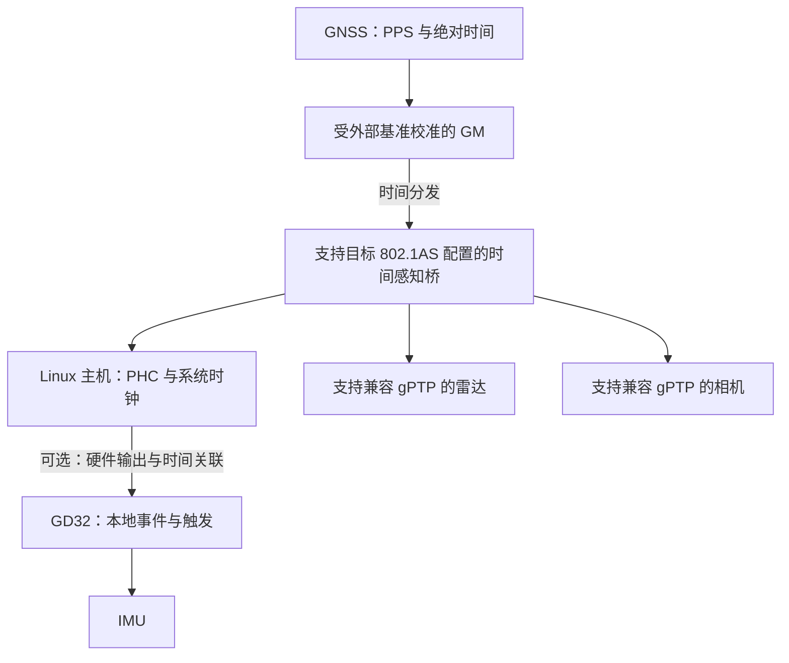
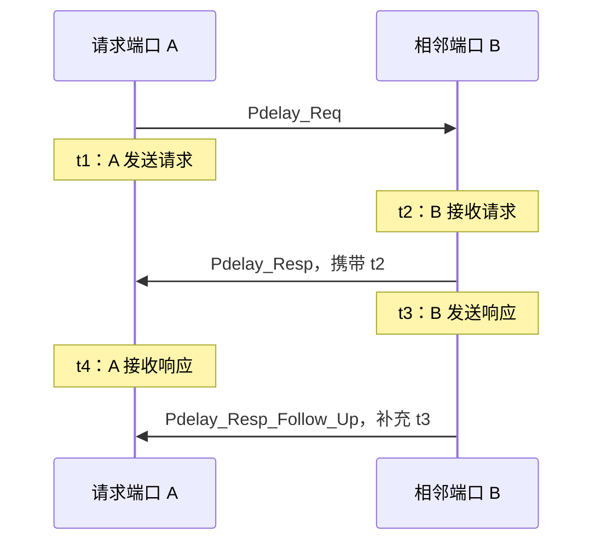

# gPTP 学习笔记：从 IEEE 802.1AS 到多传感器时间同步

上一篇 [PPS 时间同步学习笔记](/posts/pps-time-sync-learning-notes/) 用 GD32 捕获秒边沿，再输出相机和 IMU 的同步信号。当设备分散在多个以太网节点上时，就需要进一步考虑：怎样通过网络建立共同时间？交换机引入的延迟怎样计算？网络时钟同步以后，传感器采样是不是也同步了？

`gPTP` 就是理解这类问题的一条主线。这篇笔记以全双工以太网、常见的两步同步方式为例，从报文、时钟、网络设备到主机调试逐步展开。

## 1. gPTP 是什么

`gPTP` 全称为 `generalized Precision Time Protocol`，与 IEEE 802.1AS 的时间同步机制相关。它基于 IEEE 1588 的思想，为音视频、工业控制等对时间敏感的应用建立共同时间基准，是 TSN 中的重要基础。[IEEE 802.1AS 项目说明](https://1.ieee802.org/tsn/802-1as-rev/)

可以把它理解为：网络中的节点通过精确记录报文收发时刻、测量链路延迟、传播主时钟时间，使各自的时钟逐渐对齐。

但“时钟对齐”只说明设备怎样解释时间。相机何时曝光、IMU 何时采样、雷达扫描何时开始，仍由设备自身的采集机制决定。

## 2. gPTP、PTP、NTP 与 PPS 的关系

| 名称 | 基本形式 | 主要关注点 |
| --- | --- | --- |
| NTP | 通常通过 IP 网络交换时间信息 | 主机系统授时，适用范围广 |
| PTP | IEEE 1588 协议及不同应用行规 | 精密时钟同步；传输和延迟机制依行规变化 |
| gPTP | IEEE 802.1AS 相关同步机制 | 时间感知网络中的时钟分发与逐链路测量 |
| PPS | 物理脉冲边沿 | 精确标记秒边界，绝对秒编号需要其他信息 |

PTP 不是某一种固定配置。它可以采用二层以太网或 UDP/IP，可以使用不同的延迟机制、报文周期和主时钟选择规则。gPTP 的以太网实现有特定的报文和链路行为，不能把普通 PTP 配置改个名字就认为兼容。

例如 LinuxPTP 的 gPTP 示例使用二层传输、P2P 延迟测量、`transportSpecific = 0x1`，并启用 Follow_Up 信息等配置。[LinuxPTP gPTP 配置示例](https://www.linuxptp.org/documentation/configs/gptp/)

设备说明书上写“支持 PTP”时，还要核实标准版本、行规、域号、延迟机制和交换机能力。IEEE 802.1AS 不同版本及汽车等应用配置之间，也可能存在功能和参数差异。

## 3. 网络中的几个角色

| 角色或概念 | 含义 |
| --- | --- |
| Grandmaster，GM | 当前同步域中的根时间源 |
| 时间感知端节点 | 参与协议，并将网络时间提供给本地应用 |
| 时间感知桥 | 在端口上参与链路测量，并向下游传播经过校正的时间信息 |
| 同步域 | 一组按相同域配置组织的同步关系 |
| 端口角色 | 某个端口向下游提供时间，或从上游接收时间等状态 |

GM 是“网络选择谁作为基准”，不等于它一定拥有准确 UTC。GM 可以来自 GNSS、其他外部基准，也可以使用本地自由运行时钟。后者仍能建立相对共同时间，但绝对日期和长期漂移需要另行处理。



图中的每条以太网链路需要分别确认相邻设备的同步能力。普通交换机能够传输业务数据，并不意味着它会按 gPTP 的要求处理时间报文和端口延迟。

## 4. 主时钟怎样选出来

支持动态主时钟选择的配置通常通过 Announce 信息和相关选择算法，比较候选时钟的优先级、质量、身份及拓扑信息，形成同步树。常见参数包括 `priority1`、时钟质量和 `priority2`；不能只看某一个数字就判断最终结果。

主时钟选择与本地时钟伺服是两个问题：前者决定跟随谁，后者决定怎样调整本地相位与频率。选中了正确 GM，也需要一段收敛过程。

有些应用使用预先指定的主从角色，或者限制哪些设备可以成为 GM。工程中应明确主时钟策略，防止设备启动顺序变化后，某个未接入外部时间源的节点意外成为基准。

验证时记录 GM identity、上游端口、域号和切换事件。拔线、设备重启或主时钟失效后，检查是否按预期选择备用源，以及切换期间应用时间是否发生跳变。[LinuxPTP 端口与主时钟配置](https://www.linuxptp.org/documentation/ptp4l/)

## 5. 为什么需要硬件时间戳

应用调用发送函数时，报文还可能经过协议栈、排队、驱动和 DMA；接收函数返回时，报文也已经经历了接收与调度。因此，应用层看到的时刻与报文经过网口的时刻存在差异。

硬件时间戳让支持的 MAC/PHY 等硬件在更接近报文实际收发的位置记录时间，再由驱动交给协议程序。具体打点位置、收发补偿和误差仍取决于硬件与驱动。[Linux 网络时间戳文档](https://docs.kernel.org/networking/timestamping.html)

```text
应用提交报文 → 协议栈与队列 → 驱动 / DMA → MAC / PHY → 链路
                                                 ↑
                                      支持设备的硬件时间戳位置
```

软件时间戳可用于理解协议和部分调试，但不能仅凭开启 gPTP 就宣称达到某个微秒或纳秒精度。应核实硬件能力，并通过测量验证最终效果。

## 6. Pdelay：先测量相邻链路的延迟

gPTP 的全双工以太网链路通常采用 peer delay：每对相邻端口通过 `Pdelay_Req`、`Pdelay_Resp` 和两步方式下的 `Pdelay_Resp_Follow_Up` 测量链路延迟。[IEEE 工作组公开草案：延迟测量机制](https://1.ieee802.org/wp-content/uploads/2019/03/802-1AS-rev-d8-0.pdf)

### 6.1 四个时间戳分别是什么



`t1、t4` 来自 A 的时钟，`t2、t3` 来自 B 的时钟。两端的绝对偏移可以不同，因为先计算的是各自时钟上的时间间隔。

在时钟速率相同、忽略其他补偿并假设链路双向对称时，可以用下面的简化公式理解：

```text
往返链路时间 = (t4 - t1) - (t3 - t2)
平均单向延迟 d = [(t4 - t1) - (t3 - t2)] / 2
```

其中 `(t3 - t2)` 是 B 处理请求至发出响应的时间。把它扣除，才能避免将响应端的等待误认为链路传播时间。

例如 A 测得往返经过 `1100 μs`，B 的内部处理经过 `1000 μs`，则平均单向延迟为 `50 μs`。这些数值只用于展示计算，不代表某种以太网链路的典型延迟。

### 6.2 还要考虑时钟速率差

两个振荡器即使标称频率相同，实际走速也可能不同。设 `r` 表示“将 B 的时间间隔换算到 A 时间尺度”的比例，则用于理解的公式为：

```text
d_A ≈ [(t4_A - t1_A) - r × (t3_B - t2_B)] / 2
```

这里的 `r` 明确定义为 B 到 A 的换算比例，不能未经核对就直接替换成实现中的同名变量。gPTP 会估计相邻时钟的速率关系，并在时间传播和延迟计算中使用；实际实现还包含滤波、时间戳修正及链路状态处理。[IEEE 工作组公开草案：速率比与时间尺度转换](https://1.ieee802.org/wp-content/uploads/2019/03/802-1AS-rev-d8-0.pdf)

### 6.3 平均延迟不能自动消除非对称误差

若 A 到 B 为 `60 μs`，B 到 A 为 `40 μs`，平均值仍是 `50 μs`。用平均值补偿 A 到 B 的报文，会留下 `10 μs` 的偏差。

这说明残差很稳定也可能存在固定误差。需要结合链路结构、收发硬件打点位置及校准结果评估非对称性，不能把所有稳定偏差都归因于时钟伺服。

## 7. Sync 与 Follow_Up：再传播时间基准

在常见的两步方式中，发送端先发出 Sync，获得实际发送时间戳后，再用 Follow_Up 提供精确时间信息。接收端将两条消息与自己的 Sync 接收时间戳关联起来。

对于单链路、相同时间尺度、忽略额外修正的教学例子：

```text
t_send：发送端发出 Sync 的时间
t_recv：接收端收到 Sync 的本地时间
d：已测量的单向链路延迟

接收端相对发送端的偏移 θ = t_recv - (t_send + d)
```

若 `θ > 0`，表示接收端在该观测下的时间偏快。实际算法会使用多次观测，同时校正相位与频率，避免只改一次时间后再次漂移。

跨多个时间感知桥时，还要处理链路传播和桥内驻留时间，并正确换算时间尺度。实现使用报文中的修正信息和本地测量继续向下游传递时间；不能直接把跨越整条路径的收发差当作时钟偏移，也不能把已计入修正量的延迟再重复相加。

报文关联应检查源端口身份、域号和 sequence ID，并处理丢失、超时与序号回绕。Follow_Up 到达得晚不等于 Sync 测量时刻变晚：它补充的是先前事件的信息。

本文用两步流程建立理解，具体设备是否支持或使用一步方式，要按标准版本、行规和实现核对。

## 8. asCapable：链路通不等于同步可用

`asCapable` 用于表达端口对应路径是否具备所需的时间同步能力。正常的以太网连接、IP ping 成功，不能直接替代这项判断。

调试时应检查相邻端口的 Pdelay 交互、响应数量、延迟范围、时间戳质量和超时情况。延迟阈值等参数也要与目标链路匹配。[IEEE 工作组公开草案：端口能力与状态机](https://1.ieee802.org/wp-content/uploads/2019/03/802-1AS-rev-d8-0.pdf)

如果端口没有建立有效同步路径，应先定位链路和协议配置，不能为了让状态变好就盲目强制 `asCapable` 或放宽阈值。

此外，gPTP 示例使用的 `01:80:C2:00:00:0E` 是需要交换设备正确处理的链路本地组播地址。不能假设普通交换机像转发业务帧一样，把它透明地传遍整个网络。[LinuxPTP gPTP 二层配置](https://www.linuxptp.org/documentation/configs/gptp/)

## 9. Linux 中有两个需要区分的时钟

Linux 的硬件 PTP 时钟通常以 `/dev/ptpN` 暴露，简称 `PHC`。它与应用常读取的 `CLOCK_REALTIME` 是不同的时钟对象；多个网卡还可能拥有不同 PHC。[Linux PTP 硬件时钟文档](https://docs.kernel.org/driver-api/ptp.html)

```text
网络 GM
   ↓ gPTP / ptp4l
网卡 PHC
   ↓ phc2sys 或明确配置的其他时钟关联方式
系统 CLOCK_REALTIME
   ↓ 应用约定的时间戳与事件关联
图像、点云、IMU 消息
```

`ptp4l` 在硬件时间戳模式下通常负责网络协议与 PHC 同步；`phc2sys` 可以进一步同步系统时钟。只看到 ptp4l 的 offset 变小，不代表系统时间和应用消息已经正确对齐。[phc2sys 官方说明](https://www.linuxptp.org/documentation/phc2sys/)

还要明确 PTP 时间尺度与 UTC 的转换。硬件时间戳部署中，PHC 通常使用 PTP 时间尺度，系统时钟使用 UTC，转换依赖正确的 UTC 偏移及有效标志。不要将二者相差的整秒数误判为链路延迟，也不要永远硬编码一个偏移值。

## 10. Linux 实验：从网卡能力到同步状态

下面的命令是独立实验环境中的示例，接口名称按实际替换。第一阶段建议使用一条直连链路，确认端节点正常后，再接入支持目标配置的交换机。

### 10.1 检查网卡与软件能力

```bash
ip link show
ethtool -T enp3s0
ls /dev/ptp*
ptp4l -v
```

关注 `ethtool -T` 是否报告硬件收发时间戳和关联的 PTP Hardware Clock。只有软件时间戳、只有 PHC，或者驱动没有正确提供 TX 时间戳，都不能直接当作完整可用的 gPTP 硬件路径。

### 10.2 使用匹配版本的 gPTP 示例配置

从已安装 LinuxPTP 软件包或对应版本源码获取官方 `gPTP.cfg` 示例，复制为实验用的 `gptp.cfg`。先保留完整示例的设置，再按 GM 与端节点策略修改。[LinuxPTP 官方 gPTP 示例](https://www.linuxptp.org/documentation/configs/gptp/)

下列片段用于识别关键参数，**不是完整配置文件**：

```ini
[global]
network_transport L2
delay_mechanism P2P
transportSpecific 0x1
ptp_dst_mac 01:80:C2:00:00:0E
follow_up_info 1
```

还需要核对主时钟能力、域号、报文周期、超时、路径跟踪和 peer delay 阈值。`logSyncInterval` 等周期参数采用以 2 为底的指数形式，例如 `-3` 对应 `2^-3 s = 125 ms`，不是负三毫秒。

在完整配置准备好后启动：

```bash
sudo ptp4l -i enp3s0 -H -f ./gptp.cfg -m
```

观察端口角色、GM identity、同步超时以及 offset、频率修正和 peer delay 的变化。端节点若意外成为 GM，先检查选择策略与上游可达性，不要把它当作同步成功。

### 10.3 将 PHC 与系统时钟关联

当 ptp4l 已建立预期同步关系后，可以在另一个终端运行：

```bash
sudo phc2sys -a -r --transportSpecific=0x1 -m
```

`-a` 从运行中的 ptp4l 获取端口状态和时钟关系，`-r` 将系统时钟纳入同步；示例还匹配 gPTP 的 transportSpecific。若修改了域号或本地管理套接字路径，也要同步调整相关参数。[phc2sys 参数与 802.1AS 示例](https://www.linuxptp.org/documentation/phc2sys/)

应明确每个时钟由哪个程序调整。如果 phc2sys 已直接控制 `CLOCK_REALTIME`，不要再让另一个独立授时伺服同时修改它；需要与 chrony 整合时，使用明确设计的参考源链路。

### 10.4 查询状态与抓包

对于默认域号和默认本地管理套接字的示例，可以查询：

```bash
sudo pmc -u -b 0 -t 1 'GET PORT_DATA_SET'
sudo pmc -u -b 0 -t 1 'GET TIME_PROPERTIES_DATA_SET'
sudo pmc -u -b 0 -t 1 'GET TIME_STATUS_NP'
sudo tcpdump -i enp3s0 -e -nn 'ether proto 0x88f7'
```

`pmc` 通过本地管理接口读取数据；`TIME_STATUS_NP` 属于 LinuxPTP 扩展，其他实现不一定支持。域号变化时使用对应 `-d` 值，本地套接字变化时使用对应 `-s` 路径。[pmc 官方手册](https://www.linuxptp.org/documentation/pmc/)

抓包时检查 Sync、Follow_Up、Pdelay 交互和适用配置中的 Announce。`0x88f7` 是 PTP 以太网帧的 EtherType，带 VLAN 的抓包还要考虑封装。抓包工具显示的捕获时间不能未经确认就当作协议实际使用的硬件时间戳。

## 11. 与 GD32、雷达、相机和 IMU 怎样结合

### 11.1 支持兼容 gPTP 的设备

设备可以把内部时钟对齐到公共基准，然后在数据中提供测量时间戳。应用仍需查明时间戳的语义：

| 数据 | 需要确认的时间 |
| --- | --- |
| 相机图像 | 触发、曝光开始、曝光中心，还是帧传输时刻 |
| 雷达点云 | 扫描起点、包内基准点，以及每个点的相对时间 |
| IMU 数据 | 原始采样、滤波输出、DRDY 或 FIFO 内部时间 |

相机如果仍然自由运行，两个已经同步的相机也可能在不同相位曝光。需要同时曝光时，还需定时采集、约定的未来时间触发或硬件触发支持。

雷达扫描跨越一段时间，公共时钟也不会消除这段扫描过程。融合时仍需要点级时间与运动去畸变。

### 11.2 不支持 gPTP 的设备

可以采用混合方案：网络节点通过 gPTP 同步，再由具备相应能力的硬件时钟输出 PPS 或周期事件，交给 GD32 捕获与生成传感器触发。

但网卡存在 PHC，不代表它一定有可连接的 PPS 输出引脚或周期输出能力；这些功能需同时核实硬件、引脚和驱动。物理边沿之外，还应把对应的时间编号与 GD32 捕获计数关联起来。[Linux PHC 的外部事件与周期输出接口](https://docs.kernel.org/driver-api/ptp.html)

```text
gPTP 公共时间 → 可输出事件的 PHC → 物理脉冲 → GD32 捕获
公共时间编号 ─────────────────────────────→ GD32 时间映射
GD32 → 相机触发、IMU 同步、事件记录
```

GD32 本身是否能运行高精度 gPTP，要核实所选芯片的以太网 MAC、硬件时间戳、时钟调节和协议栈支持。仅有以太网接口或能接收 UDP 报文，不能说明它具备这些能力。

## 12. 常见现象与排查方向

| 现象 | 优先检查 |
| --- | --- |
| IP 通信正常，却没有同步关系 | 二层报文处理、交换机能力、域号和行规是否一致 |
| Pdelay 有请求却没有有效响应 | 相邻设备支持情况、端口配置、响应配对及硬件时间戳 |
| asCapable 无法建立 | 延迟测量结果、阈值、超时、重复响应和链路状态 |
| 端节点变成了 GM | 上游不可达、主时钟选择策略或候选设备配置 |
| offset 很小，但系统时间差很多 | PHC 到系统时钟的链路、UTC 偏移及 GM 绝对时间 |
| TX timestamp 超时 | 网卡与驱动支持、队列和时间戳交付，不先盲目调大超时 |
| 时间戳对齐了，图像与点云仍错位 | 曝光语义、逐点时间、采样相位、滤波延迟和空间外参 |
| 负载或拓扑变化后误差增大 | 链路能力、硬件打点、伺服收敛和主时钟切换 |

## 13. 怎样验证最终同步效果

至少验证三个层次：

1. **协议关系正确**：GM、域号、端口角色和 peer delay 符合预期，报文无持续超时。
2. **时钟关系正确**：PHC、系统时钟和设备时间尺度一致，长期偏移与漂移符合目标。
3. **测量事件正确**：图像、点云和 IMU 时间戳描述真实采集事件，动态融合误差符合要求。

协议日志的 offset 是在当前延迟模型下的估计值，不能单独证明绝对精度。若设备支持定时输出，可用示波器比较共同事件的边沿；验证 UTC 精度则还需要独立参考源。

同时测试网络负载、设备重启、断链、GM 切换和基准丢失。保存 GM identity、同步状态、原始时间戳与事件序号，避免失锁数据被当作正常数据继续融合。

gPTP 为 TSN 提供共同时间，但不会单独保证所有业务报文准时到达。网络调度、队列和带宽配置仍需按系统要求设计；同样，公共时钟也不能代替空间标定与测量延迟校准。

## 14. 学习与落地顺序

1. 用单链路实验理解 Pdelay 和 Sync/Follow_Up，区分时间偏移与频率偏差。
2. 核对网卡时间戳能力，确认 ptp4l 实际使用的 PHC。
3. 配置匹配的 gPTP 参数，建立预期主从关系。
4. 明确 PTP 时间尺度与 UTC，将系统时钟接入同步链路。
5. 接入时间感知交换机，验证各链路与拓扑变化。
6. 确认传感器内部时间和采样语义，再与 GD32 触发方案结合。
7. 用独立时序测量和动态融合实验验证误差，完成失锁与切换处理。

可以将本文与 [PPS 学习笔记](/posts/pps-time-sync-learning-notes/) 对照阅读：PPS 方案强调物理边沿与本地计数的关联，gPTP 方案进一步处理网络中的延迟、时间传播与时钟状态。两者结合后，仍要把每条传感器数据对应到可信的测量时刻。

## 参考资料

- [IEEE 802.1AS 项目说明](https://1.ieee802.org/tsn/802-1as-rev/)：标准范围与同步应用。
- [IEEE P802.1AS-Rev/D8.0 公开草案](https://1.ieee802.org/wp-content/uploads/2019/03/802-1AS-rev-d8-0.pdf)：理解时间传播、Pdelay、速率比与端口状态；该文档为历史草案，工程符合性以目标正式标准为准。
- [LinuxPTP gPTP 配置示例](https://www.linuxptp.org/documentation/configs/gptp/)与 [ptp4l 手册](https://www.linuxptp.org/documentation/ptp4l/)：实验配置和协议程序。
- [phc2sys 手册](https://www.linuxptp.org/documentation/phc2sys/)与 [pmc 手册](https://www.linuxptp.org/documentation/pmc/)：时钟关联与状态查询。
- [Linux PTP 硬件时钟文档](https://docs.kernel.org/driver-api/ptp.html)与 [网络时间戳文档](https://docs.kernel.org/networking/timestamping.html)：PHC、硬件时间戳和驱动接口。
