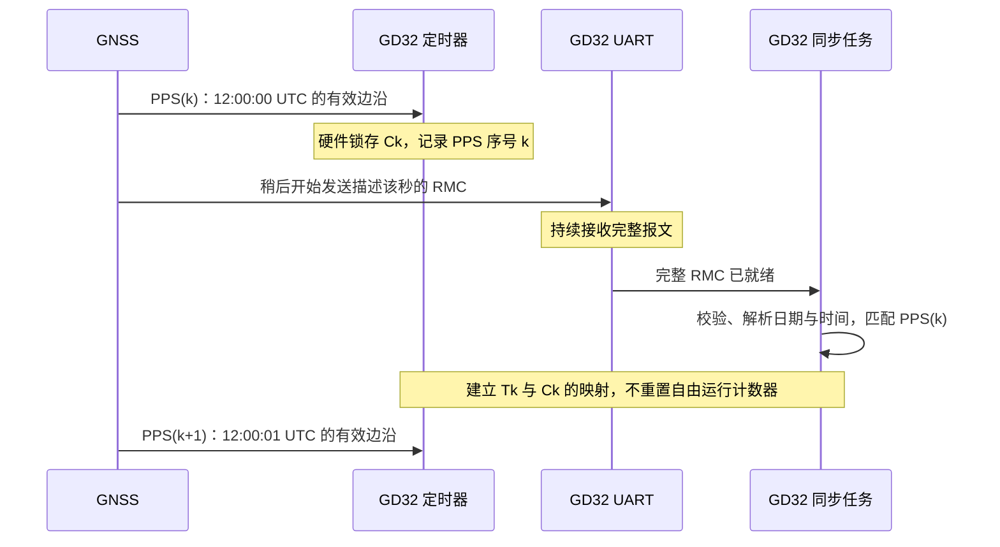
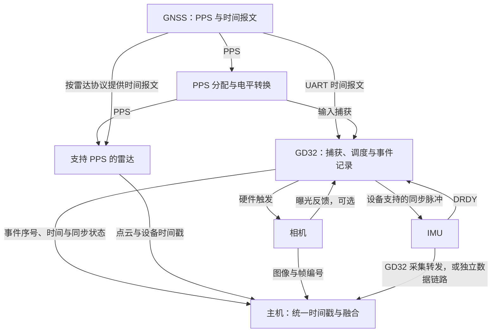

# PPS 时间同步学习笔记：用 GD32 同步雷达、相机与 IMU

做雷达、相机与 IMU 的数据融合时，空间外参解决的是“传感器装在哪里”，时间同步解决的是“这些数据对应什么时候”。如果相机记录的是当前画面，点云却来自几十毫秒之前，即使外参正确，运动时也可能出现投影错位、点云重影和融合轨迹抖动。

这篇笔记围绕一个具体方案展开：让 GD32 捕获统一时间基准，产生相机和 IMU 的同步信号，再将雷达、图像和惯性数据放到同一时间轴上。

本文暂以**支持 PPS 授时的激光雷达、支持外部触发的相机、可提供 SYNC/FSYNC 或 DRDY 信号的 IMU**为讨论对象。毫米波雷达也可以采用类似思路，但帧触发、时钟输入和时间戳协议需要按其手册设计。文中的通道名称、频率和数据结构用于说明方案，不是某个 GD32 型号可直接烧录的工程。

## 1. 先区分三个容易混在一起的概念

| 概念 | 解决的问题 | 本方案中的例子 |
| --- | --- | --- |
| 时钟同步 | 不同设备怎样使用同一时间尺度 | 雷达与 GD32 都以同一个秒边沿为基准 |
| 采样同步 | 测量动作何时发生 | GD32 每隔 50 ms 触发一次相机 |
| 时间戳对齐 | 数据的时间怎样表示、怎样关联 | 将相机曝光时间、点时间和 IMU 采样时间转换到统一时间轴 |

相机接收到共同触发，不代表它的内部时间戳已经变成 UTC；雷达已经通过 PPS 对时，也不代表每个激光点都在相机曝光的瞬间测量。

因此，需要分别回答：

- 谁提供时间基准？
- 哪条硬件信号控制或标记测量时刻？
- 数据里的时间戳究竟表示曝光、采样、扫描开始，还是主机收到数据？

## 2. PPS 提供秒边沿，时间报文提供秒的编号

`PPS` 是 `Pulse Per Second`，通常指每秒一次的脉冲，使用约定的有效边沿标记秒边界。脉冲宽度、电平、极性和失锁后的行为由时间源配置决定，不能仅凭“每秒闪一次”判断它已经有效授时。[u-blox 时间脉冲说明](https://content.u-blox.com/sites/default/files/products/documents/Timing_AppNote_%28GPS.G6-X-11007%29.pdf)

单独收到 PPS，可以知道两个边沿大约相隔一秒，却不知道这个边沿是 `2026-08-20 12:00:00 UTC`，还是另一个日期。

常见的 GNSS 授时组合是：

```text
PPS：这一秒从哪个边沿开始
NMEA / 厂商时间报文：这个边沿对应哪一个日期和秒
GD32 本地计数器：这一秒内部经过了多少时间
```

串口报文通常晚于它描述的测量时刻到达。应按照接收机的协议，把报文中的时间绑定到对应 PPS，不能把串口解析完成时刻当成整秒起点。还要确认时间尺度是 UTC 还是 GNSS 系统时间，以及时间有效标志和闰秒信息。[u-blox 接收机时间脉冲与串口时序说明](https://content.u-blox.com/sites/default/files/products/documents/u-blox6-GPS-GLONASS-QZSS-V14_ReceiverDescrProtSpec_%28GPS.G6-SW-12013%29_Public.pdf)

没有 GNSS 时，也可以由 GD32 生成本地 PPS 和触发信号，建立共同的相对时间轴。此时可实现设备间对齐，但绝对日期需要另外获得；本地时钟的精度和漂移也需要测量。

### 2.1 PPS 与 GPRMC 怎样配对

GPRMC 是 NMEA RMC 报文的一种形式，包含 UTC 时间、日期、定位状态等字段。普通 GNSS 接收机的授时来自卫星导航系统，并不是先通过 NTP 获取时间再填入 GPRMC；NTP 可以用于后续向其他主机分发时间。[u-blox RMC 与时间输出说明](https://content.u-blox.com/sites/default/files/products/documents/u-blox6-GPS-GLONASS-QZSS-V14_ReceiverDescrProtSpec_%28GPS.G6-SW-12013%29_Public.pdf)

下面假设设备手册已经确认：每个 PPS 之后输出的 RMC，描述刚刚发生的这个秒边沿。图中时间间隔用于说明先后关系，不按比例绘制。



实现时先缓存每个 PPS 的序号和捕获值，再按接收机的报文时序建立关联。检查 RMC 日期与秒编号是否连续，同时记录串口延迟范围。若报文可能跨过下一个 PPS，不能直接把它绑定到“最近一次 PPS”；应按协议和已保存的事件匹配，无法确定时保持未锁定状态。

### 2.2 串口传输延迟为什么不能忽略

对于 8N1 串口，一个字节占用 1 个起始位、8 个数据位和 1 个停止位，即 10 bit。假设一条报文含终止符共 80 字节，波特率为 9600：

```text
传输时间 = 80 × 10 / 9600 s ≈ 83.3 ms
PPS 至解析完成的时间
    = PPS 至开始发送的等待时间 + 串口传输时间 + 接收与解析延迟
```

这个计算说明，RMC 描述的时刻与“收到完整 RMC 的时刻”可以相差几十毫秒。提高波特率可以缩短传输，但不会自动消除内部等待，也不能代替 PPS 对应关系的确认。

RMC 解析至少要检查报文边界、校验和、字段完整性、UTC 时间和日期，以及相关有效状态。RMC 的日期字段通常为 `ddmmyy`，两位年份需要明确的世纪解释规则；时间字段可以包含小数秒，不应直接丢弃。定位状态也不能代替接收机专用的时间有效或 UTC 有效标志。[u-blox RMC 字段与有效性说明](https://content.u-blox.com/sites/default/files/products/documents/u-blox6-GPS-GLONASS-QZSS-V14_ReceiverDescrProtSpec_%28GPS.G6-SW-12013%29_Public.pdf)

多星座设备可能输出 `GNRMC`。GD32 解析器可根据设备协议兼容不同 talker ID，但雷达是否接受该报文头需单独确认；转换报文内容后必须重新计算校验和。内部统一保存 UTC 或约定的时间尺度，界面显示北京时间时再做 `UTC+8` 转换，避免给雷达发送带时区偏移的错误秒编号。

## 3. GD32 在系统中负责什么

建议把 GD32 当作“同步控制器”：记录基准边沿，按确定的时序输出触发，记录反馈信号，并向主机报告时间关联信息。



这张图描述逻辑关系。GNSS 串口是否能直接接雷达，要检查报文格式和电气接口；不兼容时由 GD32 转换或按厂商 SDK 的授时接口传递。

优先通过合适的缓冲器或分配电路向 GD32 与雷达分发原始 PPS。若 GD32 必须重新输出 PPS，应记录并测量输入到输出的延迟；用中断翻转 GPIO 转发，还会引入中断延迟的变化。

## 4. 先建立 GD32 的本地时间轴

### 4.1 用输入捕获记录 PPS

定时器输入捕获的关键是：有效边沿到来时，硬件将计数器值锁存到捕获寄存器，中断稍后读取这个值。读取捕获值与进入中断后读取当前计数器，是两个不同的时刻。[GD32F30x 用户手册：TIMER 输入捕获](https://www.gd32mcu.com/data/documents/userManual/GD32F30x_User_Manual_Rev2.9.pdf)

设计时需要核对具体芯片的定时器位宽、通道引脚、时钟来源、滤波器、DMA 请求和定时器互联能力。GD32 系列之间存在差异，不能把某款芯片的 TIMER 编号和引脚复用直接套到另一款上。

下面以计数频率 `10 MHz` 为例：

```text
一个 tick = 100 ns
一秒约有 10,000,000 个 tick
16 位计数器约每 6.5536 ms 回绕一次
32 位计数器约每 429.497 s 回绕一次
```

`100 ns` 是计数分辨率，并不代表整个系统达到 `100 ns` 同步精度。输入同步、滤波、电平转换、线缆和传感器内部延迟仍然存在。

尽量保留自由运行的单调计数器。在计数器位宽不够时，需要可靠的扩展计数：处理溢出与捕获同时发生的顺序，并保证不会漏记溢出；不能只靠两次 16 位捕获值相减来测量一秒。

### 4.2 建立 tick 到统一时间的映射

设某个有效 PPS 的扩展计数为 `Ck`，该边沿对应的统一时间为 `Tk`，每秒计数的估计值为 `f_est`。附近事件的时间可以估算为：

```text
T_event = Tk + (C_event - Ck) / f_est
```

例如：

```text
Tk      = 2026-08-20 12:00:00 UTC
Ck      = 100,000,000
C_event = 102,500,000
f_est   = 10,000,000 tick/s

事件时间 = 12:00:00.250000 UTC
```

实际计数频率会随晶振误差和温度变化。连续两个有效 PPS 之间的计数差可以估计一秒内的频率，多个周期可用于滤波。异常 PPS、漏脉冲或重复脉冲应先排除，再更新估计值。

在线生成触发时，只能使用此前已知的频率估计；离线处理中，则可以用前后两个已确认的 PPS 对该秒内事件插值。更新映射时还要保证时间输出连续，避免每秒更新参数造成时间戳跳变。

统一时间建议保存为 `int64` 纳秒或“整数秒 + 子秒”，本地计数使用足够宽的整数。不要用 `float` 保存 Unix 秒级时间再期待微秒精度。

### 4.3 GPRMC 解析完成后，怎样得到当前时间

参考资料常把从 PPS 到解析完成的经过时间写作 `tx`。在 GD32 中，可以直接用同一自由运行计数器计算它，而不必猜测 UART 和软件分别延迟了多少。

假设 RMC 已确认描述 `12:00:00 UTC` 的 PPS，读取当前计数的时刻得到：

```text
PPS 捕获值 Ck       = 100,000,000
当前扩展计数 C_now  = 100,923,000
估计计数频率 f_est  = 10,000,000 tick/s

tx = (C_now - Ck) / f_est = 92.3 ms
读取 C_now 时的时间 = 12:00:00.092300 UTC
```

`tx` 已包含该 PPS 至当前读取时刻的全部经过时间，不能再叠加一次 83.3 ms 的串口传输补偿。也不要将解析得到的整秒时间直接设置为“现在”，否则会把已经经过的 92.3 ms 丢掉。

解析期间可能已经发生相机触发或 IMU 数据事件。先保留这些事件的原始 tick，待 `Tk ↔ Ck` 配对确认后，再计算各自的时间戳。例如 `C_event = 100,500,000` 的事件对应 `12:00:00.050000 UTC`，不会因为时间报文在 92.3 ms 后才解析好而改变。

## 5. 用定时器产生相机和 IMU 的同步脉冲

### 5.1 一个便于理解的频率组合

假设设备支持以下工作频率：

| 信号 | 示例频率 | 用途 |
| --- | --- | --- |
| PPS | 1 Hz | 建立秒基准 |
| 相机触发 | 20 Hz | 每 50 ms 触发一帧 |
| IMU 同步输入 | 200 Hz | 每 5 ms 提供一次同步事件 |
| 雷达扫描 | 10 Hz | 读取设备扫描或点时间，不假设支持帧触发 |

相机触发可放在每秒的 `0、50、100……950 ms`，IMU 同步事件可放在 `0、5、10……995 ms`。如果硬件允许，这两组输出应共享定时基准，避免独立定时器自由运行导致相位逐渐漂移。

对于不整除计数频率的周期，可交替安排相邻整数 tick 间隔，将舍入误差分散。例如 `10 MHz` 下的 `30 Hz` 周期不能永远固定为同一个整数 tick，否则长期平均频率会有偏差。

### 5.2 输出比较与脉宽

可以按芯片能力选用输出比较、PWM、定时器主从触发或 DMA 更新比较值，在硬件上产生边沿。输出比较匹配的是计数器与比较寄存器，具体输出动作取决于配置的比较模式。[GD32F30x 用户手册：TIMER 输出比较](https://www.gd32mcu.com/data/documents/userManual/GD32F30x_User_Manual_Rev2.9.pdf)

输出信号必须同时满足设备要求的周期、最小高低电平时间和触发极性。对需要独立脉宽的触发，分别调度上升沿和下降沿，或使用合适的 PWM/单脉冲配置。

若由软件更新下一次比较值，要保证写入时目标值仍在未来，并检测错过比较窗口。涉及多个定时器时，应核实内部触发路由及它们的相位关系。

不要每到 PPS 就直接重置正在输出触发的计数器：这样可能让边界附近出现重复脉冲、漏脉冲或异常短周期。更稳妥的思路是使用连续计数和绝对比较目标，平滑校正后续事件；需要重新建立相位时，明确暂停、重启边界与状态。

## 6. 相机：记录曝光时刻，并可靠地对应到图像

相机通常需要开启外部触发，选择输入线和有效边沿，并在触发前进入采集状态。触发过快时，相机可能忽略输入；支持哪些状态和事件反馈取决于型号。[Basler 外部触发说明](https://docs.baslerweb.com/image-acquisition-and-io-control)

触发到达之后，还可能经历输入线路响应、去抖、配置的 TriggerDelay 和内部曝光启动延迟。[Basler 采集定时信息](https://zh.docs.baslerweb.com/acquisition-timing-information)

对于全局快门，如果融合算法选择曝光中心作为图像时间，可以写成：

```text
T_image = T_trigger + D_trigger_to_exposure + ExposureTime / 2
```

其中延迟需要查手册或测量，曝光时间应使用该帧实际值。若相机能输出 `ExposureActive` 等反馈，可让 GD32 捕获其边沿，辅助核对曝光时序，但仍需确认反馈信号的语义。

滚动快门每一行的曝光时刻不同，一个帧时间戳无法描述所有像素。运动较快时，还需要读出方向、行周期和曝光时间来建立逐行时间模型。

另一件同样重要的事是关联图像与触发事件。建议同时记录：

```text
GD32：启动标识、触发序号、触发计数、统一时间、同步状态
相机：Frame ID、设备时间戳、实际曝光时间、触发计数或事件信息（若支持）
```

设备可能拒绝触发，传输也可能丢帧，不能永久假设“第 N 张收到的图像就是第 N 次触发”。启动时先建立对应关系，运行中用帧编号和可用的触发/曝光反馈检查连续性，出现缺口时显式重新关联。

## 7. IMU：SYNC、FSYNC 和 DRDY 的含义要分别确认

不能假设 IMU 上名字里带 `SYNC` 的引脚都会直接启动一次采样。不同器件可能提供外部采样时钟、同步标记、分频同步或其他模式。例如 ADIS16470 提供多种外部同步模式和数据就绪输出，具体行为要查模式配置和时序。[ADIS16470 官方说明](https://www.analog.com/en/products/adis16470.html)

建议按设备能力区分三种处理方式：

| 设备能力 | GD32 的处理方式 | 能确认什么 |
| --- | --- | --- |
| 支持外部同步控制采样节奏 | 按手册配置同步模式并输出脉冲 | 采样节奏与公共基准的关系 |
| FSYNC 仅记录外部事件 | 输出标记，结合内部时间戳建立映射 | 外部边沿在 IMU 数据中的位置 |
| 只有 DRDY | 捕获 DRDY，再读取对应数据 | 数据就绪时间；采样时间仍需延迟模型 |

SPI 读完的时间属于传输完成时刻。DRDY 则通常说明数据已经准备好，也不能未经核实就当作原始采样瞬间。

数字滤波、抽取和 FIFO 会影响数据与输出之间的关系。若确定某个模式下存在有效延迟 `D_imu`，可以使用：

```text
T_imu_sample ≈ T_drdy - D_imu
```

这个延迟可能随滤波设置和信号频率变化，不能任意减去一个固定常数。使用 FIFO 时，优先保留每个样本的内部时间戳、序号和同步标记，避免把整个批次都标成一次 SPI 读取时间。

## 8. 雷达：PPS 授时与扫描触发分开处理

对支持 PPS 的激光雷达，通常还需要设备认可的时间信息来补全绝对时间。以 Livox 的部分设备为例，官方说明使用 PPS 与对应的 GPRMC 时间信息授时，并明确规定了报文与脉冲的时序要求。[Livox 官方时间同步说明](https://github.com/Livox-SDK/livox_wiki_en/blob/master/source/tutorials/new_product/common/time_sync.rst)

这只是一个设备示例，不能推断所有雷达都接受同样的接口。实施前应确认：

- PPS 输入电气标准与有效边沿。
- 时间报文通过物理串口、网络还是 SDK 输入，以及允许的时序窗口。
- 数据包的时间戳类型、单位、起点和当前同步状态。
- 时间戳描述包首点、扫描起点还是其他事件，点内相对时间如何计算。
- 是否支持扫描相位控制或帧触发；PPS 授时本身不保证支持这些功能。

若数据包时间戳对应包内基准点，第 `i` 个点有相对时间 `Δti`，可以构造：

```text
T_point_i = T_packet_reference + Δti
```

一帧旋转扫描或一个积累点云窗口会跨越一段时间。与图像融合时，应保留点级时间，并用 IMU 或运动估计进行去畸变，而不是给整帧点云统一盖上主机收包时间。

对于毫米波雷达，则要进一步查明时间戳对应 chirp、子帧还是整个 frame，并核实外部 SYNC 是否用于帧启动。它的同步接法不能直接照搬激光雷达的 PPS + GPRMC 示例。

## 9. 固件组织：边沿记录与协议处理分开

可以将 GD32 固件拆成基准捕获、时间报文解析、时钟映射、触发调度、传感器事件记录和主机通信几个模块。

下面是结构伪代码，辅助函数需要根据芯片、计数器位宽和并发方式实现：

```c
// 示意代码：硬件已在边沿到达时锁存计数。
void pps_capture_irq(void)
{
    uint64_t captured_tick = read_extended_capture_atomic();
    clear_capture_flag();
    enqueue_pps_event(captured_tick);  // 有界队列，记录溢出/丢事件
}

void sync_service(void)
{
    // 解析有效时间报文，按接收机协议绑定对应 PPS 序号。
    process_time_messages();
    validate_pps_intervals();
    update_clock_mapping_if_valid();

    // 用已确认的映射计算未来比较目标，并检查调度余量。
    prepare_future_trigger_edges();
    publish_event_records_and_sync_state();
}
```

“原子读取扩展捕获值”包含计数器回绕与捕获竞争的处理。中断里只做必要的寄存器读取和入队，耗时的报文解析、格式化输出与串口发送放到任务或主循环中。

对主机发送的记录可包含：

```text
boot_id             本次启动标识
event_type          PPS / CAMERA_TRIGGER / EXPOSURE / IMU_DRDY
event_sequence      每类事件的序号
local_tick          原始扩展计数
reference_sequence  使用的 PPS 基准序号
timestamp_ns        已确认时间尺度下的时间
sync_state          当前同步状态
time_valid          绝对时间是否有效
estimated_error_ns  基于测量与模型的误差估计
```

记录里还应明确时间尺度、版本，并提供完整性检查和消息边界。`estimated_error_ns` 需要有依据，不能因为 tick 是 100 ns 就直接填 100 ns。

## 10. 主机端：保留测量时间，也记录到达时间

主机应分别保存传感器测量时间与接收时间。前者用于融合，后者用于诊断网络、USB 或串口排队延迟。

推荐的时间链路是：

```text
相机：图像关联到触发/曝光事件 → 曝光参考时刻
IMU：内部时间戳或 DRDY + 延迟模型 → 样本参考时刻
雷达：已同步的设备时间戳 + 点内偏移 → 每个点的测量时刻
```

如果某设备只提供本地时钟，可以利用已知的共同事件估计：

```text
T_common = a * T_device + b
a：设备时钟的速率比例
b：时间偏移
```

持续使用可靠的配对事件更新映射，而不是开机减一次偏移就一直使用。没有共同事件或硬件时间关联时，仅靠主机接收时间无法消除传输延迟的不确定性。

在 ROS 等框架里，消息时间字段应采用约定的测量参考时刻，并统一时钟域。算法处理超时和耗时统计宜使用单调时钟；消息时间如果使用 UTC，则主机系统时钟也要与该基准一致。

Linux 主机若能接入 PPS，可通过 LinuxPPS 和 chrony 等工具校准系统时钟，但这属于主机授时链路；它不会自动完成图像与 GD32 触发事件的关联。[LinuxPPS 文档](https://docs.kernel.org/driver-api/pps.html)、[chrony 参考时钟配置](https://chrony-project.org/doc/4.6/chrony.conf.html)

### 10.1 工控机接入 PPS 与时间报文

对于支持 RS-232 调制解调器信号的工控机串口，PPS 可由 DCD 输入捕获，时间报文通过 RX 接收。标准 DB9 DTE 的常见定义为 1 脚 DCD、2 脚 RX、5 脚信号地；实际仍以设备手册和线缆连接为准，尤其要检查 DCD 是否真的接出。GD32 的逻辑电平不能未经转换直接接到 RS-232 接口。[LinuxPPS 接入说明](https://docs.kernel.org/driver-api/pps.html)、[GPSD 接线排查](https://www.gpsd.io/gpsd-time-service-howto.html)

物理端口标签 `COM1` 不保证一定对应 `/dev/ttyS0`；PCIe 扩展串口和 USB 串口的命名可能不同。USB 转串口能接收 RMC，也不代表支持 DCD 的 PPS 捕获，即使支持还需评估 USB 引入的延迟和抖动。[LinuxPPS 的 USB 限制](https://docs.kernel.org/driver-api/pps.html)

若主机有可用 GPIO，也可采用 `pps-gpio`。这一方式需要正确配置内核驱动、引脚复用和设备树，不能仅把 PPS 接到任意引脚就期待出现 `/dev/pps0`。

### 10.2 从接线到系统时钟，逐层检查

以下是排查命令示例，实际设备编号按本机替换。它们属于主机验证流程，不是 GD32 固件配置。

```bash
# 若发行版提供该内核配置文件，检查 PPS 与对应客户端支持。
rg '^CONFIG_PPS' "/boot/config-$(uname -r)"

# 检查已注册的 PPS 源，并确认其实际名称与关联路径。
ls /sys/class/pps/
cat /sys/class/pps/pps0/name
cat /sys/class/pps/pps0/path

# 安装 pps-tools 后，观察捕获事件。
sudo ppstest /dev/pps0

# 配置好授时程序后，观察时间源与系统时钟状态。
chronyc sources -v
chronyc tracking
```

串口 DCD 路径需要 `CONFIG_PPS` 与 `CONFIG_PPS_CLIENT_LDISC`；GPIO 路径需要相应的 `CONFIG_PPS_CLIENT_GPIO`。值为 `y` 表示内置，为 `m` 表示模块。加载 `pps_ldisc` 只提供驱动，还需要由支持它的程序将 PPS 行规程绑定到正确串口；使用 gpsd 时检查其配置和日志，避免另一个程序重复占用端口。[GPSD 内核与行规程说明](https://www.gpsd.io/gpsd-time-service-howto.html)、[ldattach 手册](https://manpages.debian.org/bookworm/util-linux/ldattach.8.en.html)

| 检查层次 | 需要确认的证据 | 仍不能据此得出的结论 |
| --- | --- | --- |
| RMC 接收 | 正确串口参数下，完整有效报文持续到达 | PPS 已接入或系统已对时 |
| PPS 捕获 | 正确来源的事件序号增加，间隔合理 | 日期、整秒编号正确或达到某个绝对精度 |
| 时间配对 | RMC 与 PPS 对应关系、时间有效标志正确 | 授时程序已经采用该源 |
| 系统授时 | chrony 选中预期时间源，跟踪状态正常 | 传感器测量时刻已正确关联 |
| 融合验证 | 帧、样本与点时间统一，动态误差符合目标 | 仅凭某次静态结果保证长期精度 |

串口调试工具应按 GNSS 手册设置波特率、数据位、校验位、停止位和流控。检查结束后释放端口，再交给 gpsd。`setserial` 中的 `baud_base` 是波特率计算基准，不是当前通信速率；不要照搬参考文章中的 I/O 地址、IRQ 或修改它来切换 9600 baud。`low_latency` 是否有效取决于驱动，应测量后决定。[setserial 参数说明](https://manpages.debian.org/bookworm/setserial/setserial.8.en.html)

### 10.3 chrony 中如何组合完整时间与 PPS

一种实现方式是：gpsd 提供基于串口报文的完整时间，chrony 直接读取 LinuxPPS 的高精度边沿，再将两者配对。下面以支持报文时间 SOCK 输出的 gpsd 3.25 及以上版本、`/dev/ttyS0` 和 `/dev/pps0` 为示例，加入现有 chrony 配置：

```text
refclock SOCK /var/run/chrony.clk.ttyS0.sock refid NMEA noselect
refclock PPS /dev/pps0 lock NMEA refid PPS
```

`NMEA` 是这里自定义的参考源标识；`noselect` 让粗时间源不直接参与系统时钟选择，`lock NMEA` 则用该源的原始样本补全 PPS 的完整时间。SOCK 路径需要与 gpsd 的设备名和运行配置一致，chronyd 应先创建套接字，再启动 gpsd；gpsd 的 `-n` 模式可使其在没有客户端时也持续读取设备。[chrony SOCK 与 PPS 配置](https://chrony-project.org/doc/4.6/chrony.conf.html)、[GPSD 运行方式](https://www.gpsd.io/gpsd-time-service-howto.html)

这两行只展示时间源关联，不能替代完整部署。要核实报文时间源的延迟是否影响正确秒的判定；需要固定偏差补偿时，按测量结果配置 `offset`，不要复制其他设备的数值。即使 `chronyc tracking` 显示残差很小，也要检查绝对日期与整秒是否正确，因为错配一整秒同样可能呈现稳定的子秒残差。

## 11. 电气连接与误差预算

### 11.1 接线前核对接口

GD32 的逻辑引脚、工业相机的隔离输入、雷达的同步口和 GNSS 的 UART 未必采用相同电平。先确认电压、输入阈值、驱动电流、极性、隔离方式与共地要求，再选择缓冲、转换或隔离电路。

长线和多个负载会改变边沿质量。需要按布线条件考虑差分传输、端接、屏蔽及接收端整形；加入滤波或隔离器后，还要测量它们造成的延迟。不能只在 GD32 输出脚看到方波，就认为传感器输入端也满足要求。

PPS 能带多少节点不能只看设备数量，要按输出驱动能力、输入电容、线长和所需边沿速度评估。节点增加时，可让原始 PPS 经过专用缓冲或分配电路形成独立支路，再核对各支路的延迟差，避免一根逻辑输出直接拖动所有设备。

UART 协议与 RS-232 电气接口也需要分开理解。一个逻辑 UART TX 是否可以扇出，要按负载和缓冲设计判断；RS-232 链路不能直接当作多节点总线。只有输入端电气兼容、负载可接受且各设备不会反向驱动时，才考虑单向分发，复杂接线宜使用独立驱动支路。

### 11.2 分辨率、固定偏差和抖动分别评估

| 误差来源 | 可能表现 | 验证方向 |
| --- | --- | --- |
| 时间源与本地晶振 | 秒边沿误差、保持期间漂移 | 对比参考源，记录温度与 PPS 周期间计数 |
| 定时器与输入通路 | 量化误差、同步与滤波延迟 | 回环捕获，核实计数时钟 |
| 信号分配与线路 | 固定延迟、边沿变慢或干扰 | 在实际设备输入端测量 |
| 相机 | 触发到曝光延迟、滚动快门 | 捕获曝光反馈，测量实际曝光 |
| IMU | 滤波延迟、FIFO 时间含义 | 比较内部时间戳、同步事件与 DRDY |
| 雷达 | 点时间解释错误、扫描时间跨度 | 检查时间戳类型与逐点偏移 |
| 主机关联 | 错配、丢帧、收包时间误用 | 检查序号、启动边界和时间域 |

能测量的固定延迟可以校准；随机抖动需要从硬件和调度链路减少。只有在误差近似独立时，才适合用平方和开根号估计综合随机误差；需要保证上界时，应分别给出各项界限并作保守估算。

## 12. PPS 丢失后怎样运行

至少区分四个状态：

| 状态 | 含义 | 建议行为 |
| --- | --- | --- |
| UNSYNCED | 尚未建立可信基准 | 明确标记时间无效或使用本地时间域 |
| ACQUIRING | 正在关联报文并验证连续 PPS | 观察周期与秒编号，不立即宣称锁定 |
| LOCKED | 基准与映射有效 | 生成触发，输出有效时间与误差估计 |
| HOLDOVER | 基准丢失，暂用本地频率估计 | 保持连续触发，随时间增大误差估计 |

保持期间的粗略漂移模型是：

```text
新增时间误差 ≈ 残余频率误差 × 失去基准的时长
```

例如残余频率误差为 `20 ppm`，失去基准 `10 s`，仅该项就可能累计约 `200 μs`；还需考虑起始误差和温度变化。达到应用允许的误差上限后，应降低同步可信度或停止相关融合。

PPS 恢复时先验证连续性和绝对秒编号，再恢复锁定。重新校正相位时避免突变触发周期，并把失锁、重锁和重新关联事件通知主机。

## 13. 怎样验证三种传感器真的对齐

### 13.1 先验证硬件时序

用示波器或逻辑分析仪同时观察 PPS、相机触发、IMU 同步和可用的反馈信号，测量周期、脉宽、相位、输入到输出的延迟及其变化。特别检查整秒边界、长时间运行、计数器回绕和丢 PPS 后恢复的行为。

仅比较同一 GD32 生成的两个输出，可以验证相对时序；验证绝对授时精度还需要独立参考时间源。

### 13.2 再验证事件与数据的对应

统计 GD32 触发计数、相机实际帧数、IMU 样本序号与雷达同步状态。人为制造丢帧、读取延迟和设备重启，检查事件对应关系是否仍正确，是否能检测并恢复断点。

### 13.3 最后做动态实验

让传感器共同观察受控运动，比较图像变化、点云变化和 IMU 信号对应的时间。可利用可见运动靶、转台或其他重复运动进行验证，记录残余时间偏移的均值、分布和随时间的漂移。

静止场景往往无法暴露时间错位。动态实验也需要控制空间外参、曝光和传感器滤波影响，避免把其他误差全部解释成时间同步问题。

## 14. 一个可逐步落地的顺序

1. 确认芯片与传感器型号，列出引脚、电气接口和时间戳语义。
2. 单独实现 GD32 自由运行计数与 PPS 捕获，验证溢出和有效性检查。
3. 关联 GNSS 时间报文与 PPS，建立连续的统一时间映射。
4. 单独接入相机，验证硬件触发、曝光反馈和图像关联。
5. 接入 IMU，确认同步模式、数据序号和滤波延迟。
6. 接入雷达，验证授时状态、时间尺度和点级时间。
7. 主机统一时间域并保留原始信息，完成丢帧、失锁与重启测试。
8. 用动态实验评估最终同步误差，再用于数据融合。

可以结合 [EtherCAT 学习笔记](/posts/ethercat-learning-notes/) 中的同步部分理解共同原则：先建立可信时钟，再确认测量事件与时钟的关系，最后验证数据时间戳。GD32 在这里承担的是硬件事件控制与记录，传感器协议和主机关联共同决定最终效果。

## 参考资料

- [GD32F30x 用户手册](https://www.gd32mcu.com/data/documents/userManual/GD32F30x_User_Manual_Rev2.9.pdf)：输入捕获、输出比较及定时器工作机制；具体工程使用所选芯片的手册。
- [u-blox GPS-based Timing](https://content.u-blox.com/sites/default/files/products/documents/Timing_AppNote_%28GPS.G6-X-11007%29.pdf)：时间脉冲与授时配置。
- [Livox 官方时间同步说明](https://github.com/Livox-SDK/livox_wiki_en/blob/master/source/tutorials/new_product/common/time_sync.rst)：支持设备的 PPS 与 GPRMC 时序。
- [Basler 采集定时信息](https://zh.docs.baslerweb.com/acquisition-timing-information)：触发到曝光的延迟来源。
- [ADIS16470 官方资料](https://www.analog.com/en/products/adis16470.html)：外部同步与数据就绪功能。
- [LinuxPPS 文档](https://docs.kernel.org/driver-api/pps.html)与 [chrony 配置手册](https://chrony-project.org/doc/4.6/chrony.conf.html)：主机授时链路。
- [GPSD 授时指南](https://www.gpsd.io/gpsd-time-service-howto.html)：串口与 PPS 接入、时间源输出和排查方法。
- [ldattach 手册](https://manpages.debian.org/bookworm/util-linux/ldattach.8.en.html)与 [setserial 手册](https://manpages.debian.org/bookworm/setserial/setserial.8.en.html)：Linux 串口行规程与参数含义。
